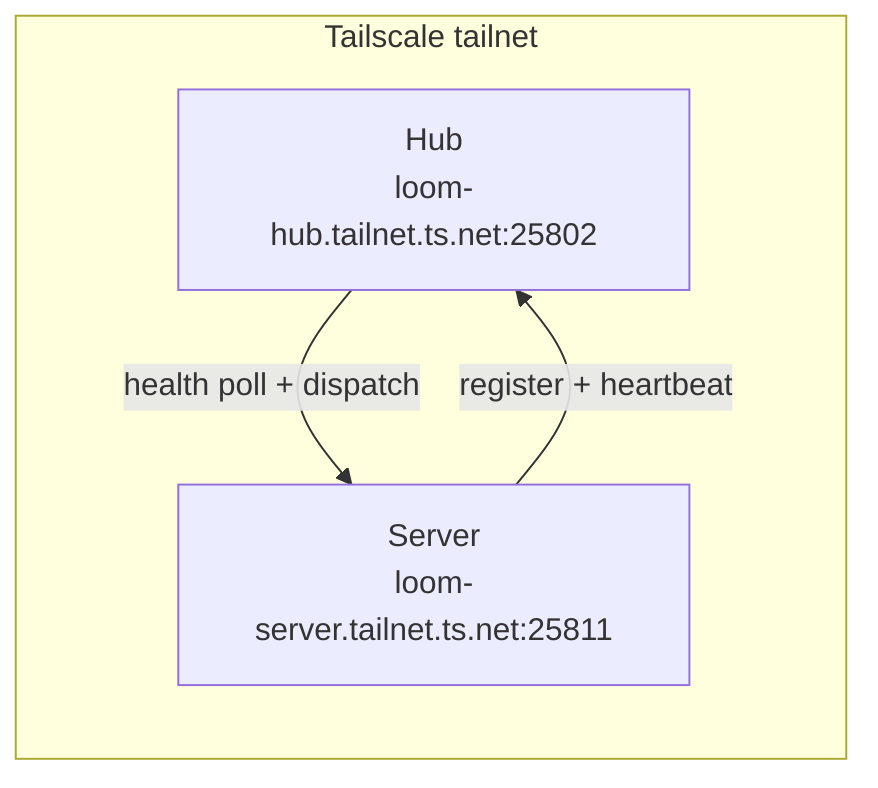

# Remote Loom Server over Tailscale

This example connects a Loom **Server** that runs somewhere the **Hub** cannot
reach directly - a home lab, an on-prem machine, or a separate cloud/VPC - by
joining both ends to the same [Tailscale](https://tailscale.com) tailnet.

A Tailscale sidecar container owns the network namespace; the Server shares it
with `network_mode: service:tailscale`, so the Server is reachable on the
tailnet at its MagicDNS name (`<hostname>.<tailnet>.ts.net`).

## Why this is needed

Loom's Hub uses a *pull* model for Servers: after a Server registers, the Hub
polls it for health and dispatches executions to it. That only works if the Hub
can open connections to the Server's advertised address.



The Server tells the Hub where to reach it via `PUBLIC_ENDPOINT_URL`. By default
a Server advertises its local bind address (`http://localhost:25811`), which a
Hub on a different host cannot reach. Setting `PUBLIC_ENDPOINT_URL` to the
Server's MagicDNS name fixes this.

## Prerequisites

1. A Tailscale account and a **reusable** auth key
   (Tailscale admin console -> Settings -> Keys). An *ephemeral* key is
   recommended for disposable hosts.
2. The **Hub already on the same tailnet**. Run the Hub stack on a tailnet
   host, or expose it with a Tailscale subnet router. The Server's `HUB_URL`
   must be the Hub's MagicDNS name, e.g.
   `http://loom-hub.tailnet-name.ts.net:25802`.
3. Hub credentials for this Server (provision exactly as the main stack):
   - `HUB_REGISTRATION_SECRET` - matches the Hub's `SERVER_REGISTRATION_SECRET`.
   - `HUB_SERVER_TOKEN` - this Server's auth token registered in the Hub.

## Setup

```bash
cd docker/sidecar
cp .env.example .env
# Fill in: TS_AUTHKEY, TS_HOSTNAME, TS_TAILNET, HUB_URL,
#          HUB_REGISTRATION_SECRET, HUB_SERVER_TOKEN, SERVER_NAME
docker compose -f docker-compose.tailscale.yml up -d
```

Then verify:

1. The node appears in your Tailscale admin console under the chosen
   `TS_HOSTNAME`.
2. From the Hub host, `curl http://<TS_HOSTNAME>.<TS_TAILNET>.ts.net:25811/api/health`
   returns a response.
3. The Server shows up on the Hub's **Servers** page as online.

## Files

| File | Purpose |
| --- | --- |
| `docker-compose.tailscale.yml` | Tailscale sidecar + Loom Server sharing its network namespace. |
| `.env.example` | Template for the Tailscale key, tailnet, and Hub credentials. |

## Notes

- The `tailscale` service needs `NET_ADMIN` and `/dev/net/tun`. On hosts where
  the TUN device is unavailable, set `TS_USERSPACE=true` (userspace networking)
  in the compose file.
- This pattern also works with WireGuard or any overlay network: the only Loom
  requirement is that `PUBLIC_ENDPOINT_URL` is an address the Hub can reach.
- Mount the data this Server is allowed to read via `SERVER_DATA_DIR` (it is
  bind-mounted read-only at `/app/data/files`).
