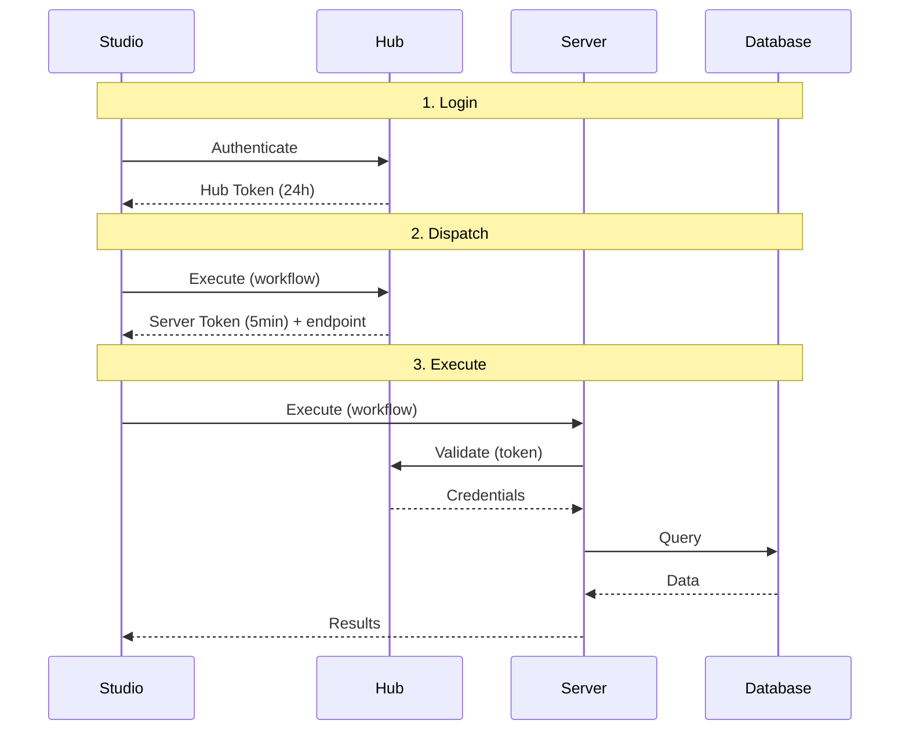

# Security Model

Hub implements a zero-trust security model. The core principle: **users never see credentials**.

## Zero-Trust Execution

When a user executes a workflow:

1. **Login** - User authenticates, receives Hub Token (24h)
2. **Dispatch** - User requests execution, Hub validates permissions and issues Server Token (5 min, single-use, workflow-bound)
3. **Execute** - Server validates token with Hub, receives credentials just-in-time, executes, discards credentials

**Credentials only flow Hub to Server, never to users.**

## Attack Mitigations

| Attack | Mitigation |
|--------|------------|
| Token replay | Single-use; marked consumed after validation |
| Token forgery | Signed JWT; tampering invalidates |
| Workflow swap | Workflow hash embedded in token; mismatch rejects |
| Unauthorized connection | Token scoped to specific connections |
| Expired token | 5-minute TTL; Hub rejects expired |
| Code injection via expressions | AST validation allowlist before `eval()` (see below) |
| SSRF via AI proxy | Private/loopback/link-local IP blocking + DNS resolution check |
| SQL injection via database tool | DDL/DML keyword rejection before query execution |
| Default/weak secrets | Hub refuses to start with default secret values |
| Timing attacks on secrets | `secrets.compare_digest` for registration secret comparison |

## Credential Storage

Credentials are encrypted at rest using Fernet (AES-128-CBC + HMAC-SHA256). The encryption key is stored in `CONNECTION_ENCRYPTION_KEY` environment variable, separate from the database.

:::warning Key Loss
If you lose the encryption key, all Hub connections become unrecoverable. Back up your key securely.
:::

## Role Enforcement

API endpoints enforce role requirements. See [Roles and Permissions](./roles) for the permission matrix.

- Admins manage infrastructure but cannot execute workflows
- Users execute workflows but cannot manage infrastructure
- Auditors have read-only access to everything

## Expression Sandboxing

Several tools (Formula, Filter, etc.) accept user-written Polars expressions that are evaluated via Python's `eval()`. To prevent arbitrary code execution, every expression passes through an **AST validation allowlist** before evaluation:

- Only Polars-safe AST node types are permitted (calls, attributes, comparisons, boolean ops, literals)
- Names are restricted to `pl`, `True`, `False`, and `None`
- Double-underscore (`__`) attribute access is blocked (prevents `__class__.__bases__` sandbox escapes)
- Lambda expressions and comprehensions are rejected
- The `eval()` namespace is restricted to Polars functions only

Expressions that fail validation are rejected with a descriptive error before any code executes.

## AI Proxy Protection

The Server includes an AI proxy endpoint that forwards requests to LLM providers (OpenAI, Anthropic, etc.) for in-app AI assistance. This endpoint is hardened against SSRF:

- **IP validation** — Target URLs are resolved and checked against private (RFC 1918), loopback, link-local (169.254.x.x), and reserved IP ranges
- **Hostname blocking** — Known internal hostnames (`localhost`, `metadata.google.internal`, etc.) are rejected
- **Header allowlist** — Only safe headers (`content-type`, `accept`, `authorization`, provider-specific headers) are forwarded; all others are stripped
- **Internal token filtering** — Authorization headers with internal `Bearer sw-` prefixes are never forwarded upstream

## Database Query Safety

When users inspect or preview database tables, the query input is validated to reject destructive operations:

- A regex filter blocks DDL/DML keywords: `DROP`, `ALTER`, `CREATE`, `DELETE`, `UPDATE`, `INSERT`, `TRUNCATE`, `GRANT`, `REVOKE`, `EXEC`/`EXECUTE`, `CALL`
- SQL comments are stripped before validation to prevent bypass via `/* DROP */`
- Both `inspect()` and `preview()` paths enforce the check

## Startup Secret Validation

Hub validates secrets at startup to prevent running with insecure defaults:

- `SESSION_SECRET` and `SECRET_KEY` must not equal `CHANGE_ME_IN_PRODUCTION` (fatal)
- Empty `SERVER_REGISTRATION_SECRET` triggers a warning (allows open server registration)
- Docker entrypoint validates all required environment variables are set
