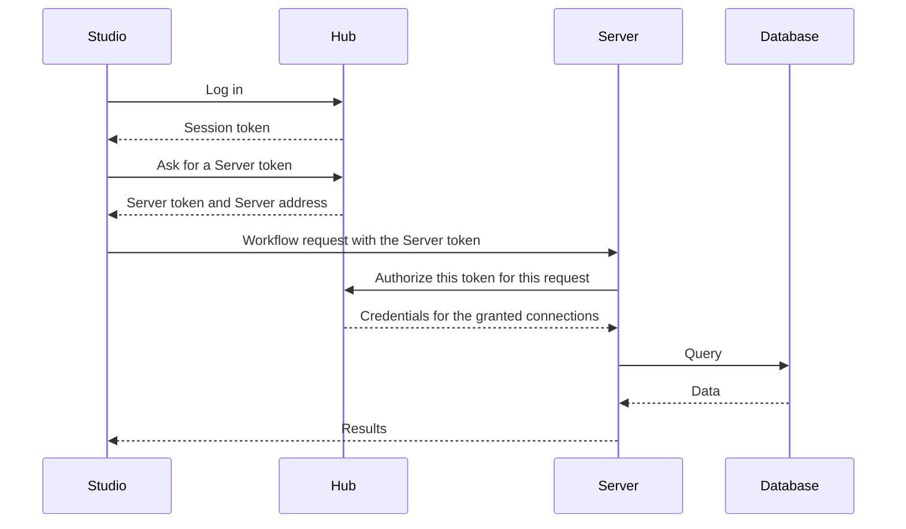

# Security Model

What Hub protects, how, and where the limits are. Read this before you put real credentials into Hub.

:::note Pre-1.0
Loom has not had an external security audit, and parts of the security design are still being hardened. This page describes how things work today. It does not promise more than that. Report vulnerabilities as described in [SECURITY.md](https://github.com/Sigilweaver/Loom/blob/main/SECURITY.md).
:::

## The main idea

**Users never receive database credentials.** Credentials for Hub connections live in Hub, encrypted. A Server receives them only while it is handling a request that a user is entitled to make.

## How a Hub-mode request works

1. **Log in.** Studio sends the username and password to Hub. Hub verifies the password and returns a session token. Sessions last 24 hours by default.
2. **Get a Server token.** Studio asks Hub for a token for a healthy Server. Hub issues a random, opaque token that is valid for five minutes by default and records who asked for it and for which Server.
3. **Call the Server.** Studio sends the workflow to the Server with that token.
4. **Authorize.** The Server presents the token to Hub. Hub consumes the token, so it works once, checks that the user is entitled to every Hub connection the workflow uses, and returns the credentials for those connections and the file paths the user may use.
5. **Run.** The Server executes with those credentials and does not keep them.

Credentials travel from Hub to the Server. They do not go to Studio or to the user.

## What this defends against

| Threat                                | Defense today                                                                        |
| ------------------------------------- | ------------------------------------------------------------------------------------ |
| Replaying a token                     | Server tokens are consumed the first time a Server uses them.                        |
| Guessing or forging a token           | Tokens are random and unguessable, and Hub validates them by lookup.                 |
| A stolen, old token                   | Tokens expire after `SERVER_TOKEN_TTL_SECONDS` (five minutes by default).            |
| A token used on the wrong Server      | A token is issued for one Server, and Hub checks that Server's identity when it consumes the token. |
| Using a connection you were not granted | Hub checks the user's grants at authorize time, not only in the interface.          |
| Weak or missing secrets               | Hub refuses to start with an empty `SESSION_SECRET`, `SECRET_KEY`, `CONNECTION_ENCRYPTION_KEY` or `SERVER_REGISTRATION_SECRET`. |
| Fake Servers registering              | Registration needs the shared registration secret, compared in constant time.        |
| Password theft from the database      | Passwords are hashed with Argon2id.                                                  |
| Credential theft from the database    | Connection credentials are encrypted with Fernet. The key is not in the database.    |
| Leaked tokens in the audit trail      | The audit log stores identities and counts, not credentials.                         |

Tokens are held in memory by default, so a Hub restart invalidates every token that is in flight. That fails safe. See [Hub Open Beta](./hub-beta.md).

## What you still have to do

- **Trust your Servers.** A Server receives plaintext credentials while it works, and it executes workflows. Anyone with shell access to a Server host can read what the Server process can read. Run Servers on hosts you control.
- **Use HTTPS.** Without TLS, session tokens, Server tokens and passwords cross the network in clear text. See [HTTPS with Caddy](./deployment.md#https-with-caddy).
- **Protect the Owner account.** The first registration on a fresh Hub becomes the Owner. Register it before anyone else can reach Hub.
- **Use read-only database logins.** Loom rejects queries that contain write or DDL keywords, but that is a filter, not a substitute for database permissions.
- **Set file access deliberately.** See [file access](#file-access).
- **Back up the encryption key.** Losing `CONNECTION_ENCRYPTION_KEY` makes stored connections unrecoverable, and leaking it lets anyone with a database copy read them.

## Credential storage

Hub encrypts connection credentials with Fernet (AES-128-CBC with an HMAC-SHA256 integrity check) before writing them to PostgreSQL. The key is `CONNECTION_ENCRYPTION_KEY`, and it lives outside the database.

Hub's API never returns credentials. It returns names, types, hosts, health and read-only flags to authorized roles. Users see only the name, type and health of connections they were granted.

## Roles

Every API endpoint checks the caller's role. See [Roles and Permissions](./roles.md). In short: Owners and Admins manage infrastructure but cannot run workflows, Users run workflows but cannot administer, and Auditors read everything.

## File access

A Server decides which files workflows may touch. In Hub mode, the Server allows only the paths that Hub grants to the requesting user through filesystem connections. Outside Hub mode, the Server's `FILE_ACCESS_MODE` decides. `open` means no restriction. See [Server Configuration](./server-configuration.md#file-access). Set `allowlist` or `hub` on any shared Server. SQLite database paths (`sqlite://`) go through the same checks as file inputs, including Hub file grants. The desktop apps only read or write files you picked in a native open or save dialog in the current session.

## Expressions and code

Filter and Calculate accept Polars expressions. Loom runs each expression in an allowlist sandbox. It sees only a restricted `pl` namespace, and file and network I/O, callables and format-string tricks are blocked. This lowers the risk, but it is not a guarantee. **Treat a workflow file like a script**: open workflows from people you trust, and remember that a workflow runs with the permissions of the Server process.

On a single-user desktop, the workflow author already controls the host, though native file reads and writes still require dialog grants. In Hub mode, workflow authors are untrusted relative to the Server: the expression allowlist prevents expressions from reaching Polars readers or Python callables that bypass per-request file and connection grants. Run shared Servers with `FILE_ACCESS_MODE=hub`, least-privilege database accounts and host permissions. The allowlist is not process isolation or a total memory limit; trusted Server hosts and grant enforcement remain part of the boundary.

## AI proxy

The Server includes a proxy that forwards Studio's AI requests to the model provider. It refuses to connect to loopback, private, link-local and other reserved addresses, resolves names before connecting to prevent DNS tricks, and forwards only an allowlist of headers. It never forwards Loom's own tokens. Studio sends workflow context and sample data to the provider you configure. See [AI Assistant](../user/interface/ai-assistant.md).

## Audit log

Hub records events in a tamper-evident log. Each event stores a SHA-256 hash that covers its content and the previous event's hash. **Admin > Audit Log** lets auditors filter events and verify the chain for the most recent events.

Today Hub logs two kinds of events:

- `capability.token_issued`: a user asked for a Server token.
- `authorize.execute`, `authorize.preview` and `authorize.browse`: a Server asked Hub to authorize a request, with the number of connections and file paths involved.

Logins, user changes and other administrative actions are not in this log yet.

The Server keeps its own separate request log. See [Server Configuration](./server-configuration.md#audit-log).

## Startup checks

- Hub validates that the four required secrets are set. `ALLOW_INSECURE_DEFAULTS=true` replaces missing ones with random values for development only.
- The Hub container entrypoint also checks `DATABASE_URL` and rejects the literal placeholder `CHANGE_ME_IN_PRODUCTION` for secrets.
- A Server in `static` mode refuses to start without a token, and a Server in `hub` mode refuses to start without `HUB_URL`.
- A Server with contradictory file-access settings refuses to start.
