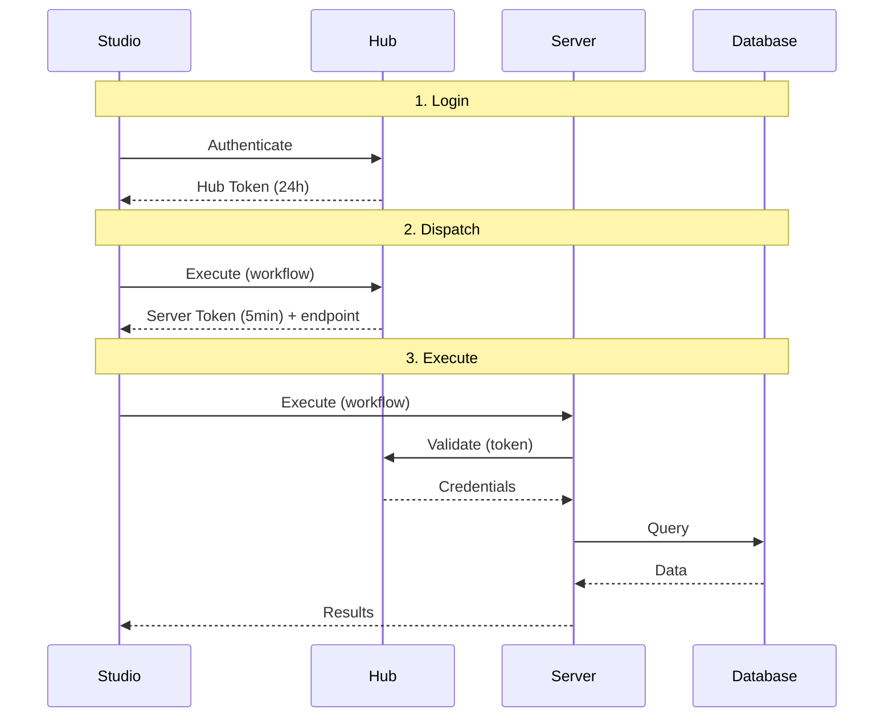

# Security Model

Hub implements a zero-trust security model. The core principle: **users never see credentials**.

## Zero-Trust Execution

When a user executes a workflow:

1. **Login** - User authenticates, receives Hub Token (24h)
2. **Dispatch** - User requests execution, Hub validates permissions and issues Server Token (5 min, single-use, workflow-bound)
3. **Execute** - Server validates token with Hub, receives credentials just-in-time, executes, discards credentials

**Credentials only flow Hub to Server, never to users.**

## Attack Mitigations

| Attack | Mitigation |
|--------|------------|
| Token replay | Single-use; marked consumed after validation |
| Token forgery | Signed JWT; tampering invalidates |
| Workflow swap | Workflow hash embedded in token; mismatch rejects |
| Unauthorized connection | Token scoped to specific connections |
| Expired token | 5-minute TTL; Hub rejects expired |

## Credential Storage

Credentials are encrypted at rest using Fernet (AES-128-CBC + HMAC-SHA256). The encryption key is stored in `CONNECTION_ENCRYPTION_KEY` environment variable, separate from the database.

:::warning Key Loss
If you lose the encryption key, all Hub connections become unrecoverable. Back up your key securely.
:::

## Role Enforcement

API endpoints enforce role requirements. See [Roles and Permissions](./roles) for the permission matrix.

- Admins manage infrastructure but cannot execute workflows
- Users execute workflows but cannot manage infrastructure
- Auditors have read-only access to everything
