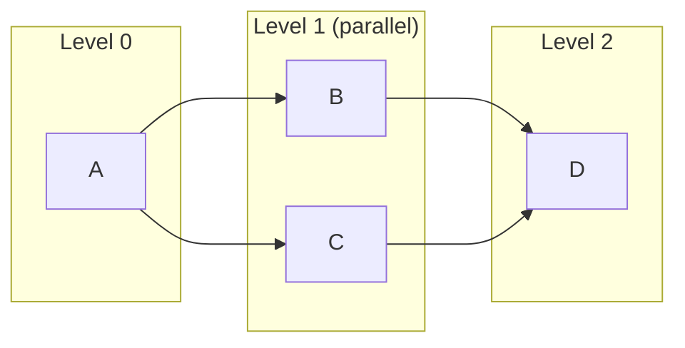

# Server Architecture

The Server is a Python service that handles all data processing. It loads files, executes tool transformations, and returns results to the Studio. The Studio never touches actual data. It works with schemas and previews.

## Technology Stack

| Layer | Technology | Why |
|-------|------------|-----|
| Framework | FastAPI | Async, fast, great DX, OpenAPI docs |
| Data | Polars | Lazy evaluation, blazing performance |
| Validation | Pydantic | Type-safe request/response models |
| Packaging | PyInstaller | Single-file executable distribution |

## Directory Structure

```
server/app/
├── main.py              # FastAPI entrypoint
├── config.py            # Settings and configuration
│
├── api/                 # HTTP layer
│   ├── router.py        # Route aggregation
│   ├── routes/          # Endpoint handlers
│   │   ├── health.py    # Health check
│   │   ├── workflow.py  # Workflow execution, schema, preview
│   │   ├── datasource.py   # Data source inspection
│   │   ├── connections.py  # Connection CRUD
│   │   ├── archive.py      # Execution archive
│   │   ├── cache.py        # Cache management
│   │   ├── files.py        # File browsing
│   │   └── polars.py       # Polars introspection
│   └── models/          # Pydantic schemas
│       ├── workflow.py  # Workflow, Tool, Wire
│       ├── common.py    # DataSchema, DataPreview
│       └── connections.py  # Connection request/response
│
├── domain/              # Business logic
│   ├── tools/           # Tool implementations
│   │   ├── base.py      # BaseTool ABC
│   │   ├── registry.py  # Tool registry + decorator
│   │   ├── register.py  # Imports all tools
│   │   ├── sockets.py   # Socket ID constants (shared with Studio)
│   │   └── implementations/
│   │       ├── input.py
│   │       ├── filter.py
│   │       ├── select.py
│   │       └── ...
│   ├── execution/       # Workflow execution
│   │   ├── executor.py  # Main executor (orchestration)
│   │   ├── planner.py   # ExecutionPlanner + ExecutionPlan
│   │   ├── cache_manager.py  # CacheManager (lineage + caching)
│   │   ├── graph.py     # Dependency resolution
│   │   └── cache.py     # BlockingToolCache (disk storage)
│   ├── workflow/        # Workflow utilities
│   │   └── archive.py   # Audit archiving
│   ├── datasources/     # File type handlers
│   │   ├── factory.py   # Datasource factory
│   │   ├── csv.py       # CSV loader
│   │   ├── database.py  # Database query loader
│   │   └── parquet.py   # Parquet loader
│   └── connections/     # Credential management
│       ├── models.py    # Connection data models
│       └── store.py     # Encrypted credential store
│
├── middleware/          # Request middleware
│   └── audit.py         # Audit logging
│
└── utils/               # Shared utilities
    ├── errors.py        # Custom exceptions
    └── type_mapping.py  # Polars ↔ JSON type conversion
```

## Tool System

The heart of the Server. Every transformation (Filter, Select, Join, etc.) is a Tool.

### Socket ID Constants

Tool inputs and outputs use named "sockets" to connect together. To prevent mismatches between Studio and Server, socket IDs are defined as constants in both layers:

**Server** (`app/domain/tools/sockets.py`):
```python
class CommonSockets:
    INPUT = "input"
    OUTPUT = "output"

class FilterSockets:
    INPUT = "input"
    OUTPUT_TRUE = "output-true"
    OUTPUT_FALSE = "output-false"

class JoinSockets:
    INPUT_LEFT = "input-left"
    INPUT_RIGHT = "input-right"
    OUTPUT_LEFT = "output-left"
    OUTPUT_MATCH = "output-match"
    OUTPUT_RIGHT = "output-right"
```

**Studio** (`src/domain/workflow/constants/socketIds.ts`):
```typescript
export const CommonSockets = {
  INPUT: "input",
  OUTPUT: "output",
} as const;

export const FilterSockets = {
  INPUT: "input",
  OUTPUT_TRUE: "output-true",
  OUTPUT_FALSE: "output-false",
} as const;
```

These constants are validated by type contract tests that ensure Studio and Server stay in sync.

### BaseTool Interface

All tools inherit from `BaseTool`:

```python
from app.api.models.workflow import DEFAULT_ENGINE

class BaseTool(ABC):
    engine: str = DEFAULT_ENGINE  # "core/polars" by default

    @abstractmethod
    async def execute(
        self, 
        config: dict[str, Any], 
        inputs: dict[str, pl.LazyFrame | list[pl.LazyFrame]]
    ) -> dict[str, pl.LazyFrame]:
        """Execute tool logic. Returns LazyFrames."""
        pass
    
    @abstractmethod
    async def get_output_schema(
        self, 
        config: dict[str, Any], 
        input_schemas: dict[str, DataSchema | list[DataSchema]]
    ) -> dict[str, DataSchema]:
        """Return schema without execution (for UI dropdowns)."""
        pass
    
    async def validate_config(self, config: dict[str, Any]) -> list[str]:
        """Validate configuration. Return error messages."""
        return []
```

Key design decisions:

1. **Async by default**: All methods are async, even if they don't need it. Consistency matters.
2. **LazyFrame in, LazyFrame out**: Keep execution lazy. Never call `.collect()` unless you must.
3. **Socket-based I/O**: Tools can have multiple inputs/outputs. The dict key is the socket ID.
4. **Schema without execution**: `get_output_schema` lets the UI know what columns will exist without running the pipeline.

### Tool Registry

Tools self-register using a decorator:

```python
# server/app/domain/tools/implementations/filter.py
from app.domain.tools.registry import register_tool

@register_tool("Filter")  # This string must match Studio tool type
class FilterTool(BaseTool):
    async def execute(self, config, inputs):
        lf = inputs["input"]
        expression = config.get("expression", "")
        # ... filter logic
        return {"output-true": true_result, "output-false": false_result}
```

The registry is a simple class-level dict:

```python
class ToolRegistry:
    _tools: dict[str, Type[BaseTool]] = {}
    
    @classmethod
    def register(cls, tool_type: str, tool_class: Type[BaseTool]):
        cls._tools[tool_type] = tool_class
        # Also registers under engine-qualified key:
        # e.g., "core/polars::Filter"
    
    @classmethod
    def get(cls, tool_type: str, engine: str | None = None) -> BaseTool:
        # Tries "{engine}::{tool_type}" first, then plain "{tool_type}"
        return cls._tools[tool_type]()
```

All tool implementations are imported in `register.py`, which triggers the decorators:

```python
# server/app/domain/tools/register.py
from app.domain.tools.implementations import (
    input,
    output,
    filter,
    select,
    sort,
    formula,
    sample,
    unique,
    join,
    union,
    summarize,
    pivot,
    unpivot,
)
```

And `register.py` is imported in `main.py`:

```python
# server/app/main.py
import app.domain.tools.register  # noqa: F401
```

This ensures all tools are registered before any API request.

### Expression Security

Tools like Filter and Formula accept user-written Polars expressions. These are evaluated via Python's `eval()` with a restricted namespace, but the primary security boundary is **AST validation** (`app/utils/expression.py`):

1. The expression string is parsed with `ast.parse(expression, mode="eval")`
2. Every AST node is checked against an allowlist of safe types (calls, attributes, comparisons, literals, etc.)
3. Only `pl`, `True`, `False`, and `None` are permitted as name nodes
4. Double-underscore (`__`) attribute access is blocked to prevent sandbox escapes
5. Lambda expressions and comprehensions are rejected

This runs **before** `eval()`, so malformed or malicious expressions never reach the interpreter.

## Execution Engine

The execution engine orchestrates workflow execution. It has been decomposed into three focused components:

| Component | File | Responsibility |
|-----------|------|----------------|
| **ExecutionPlanner** | `planner.py` | Builds execution plans, topological sort |
| **CacheManager** | `cache_manager.py` | Lineage hashes, cache decisions |
| **WorkflowExecutor** | `executor.py` | Orchestrates execution, tool invocation |

### ExecutionPlanner

The `ExecutionPlanner` creates an immutable `ExecutionPlan` that determines what needs to execute and in what order:

```python
from app.domain.execution.planner import ExecutionPlanner

planner = ExecutionPlanner(workflow)
plan = planner.create_plan(target_tool_id="output-1")

# Iterate over tool IDs in execution order
for tool_id in plan:
    tool = plan.get_tool(tool_id)
    inputs = plan.get_inputs(tool_id)
    dependencies = plan.get_dependencies(tool_id)
```

The `ExecutionPlan` is immutable (uses frozen dataclass with tuples) and provides:
- `execution_order`: Topological sort of tool IDs
- `get_tool(tool_id)`: Access tool by ID
- `get_inputs(tool_id)`: Input socket mappings
- `get_dependencies(tool_id)`: Upstream tool IDs
- `get_execution_levels()`: Groups for parallel execution

### CacheManager

The `CacheManager` handles all caching decisions and lineage tracking:

```python
from app.domain.execution.cache_manager import CacheManager

cache_mgr = CacheManager(workflow_id, force_refresh=False)

# Compute lineage hash (includes upstream state)
lineage_hash = cache_mgr.compute_lineage_hash(tool, plan)

# Check for cached outputs
cached = cache_mgr.check_cache(tool, lineage_hash)
if cached:
    # Use cached outputs
    pass
else:
    # Execute tool, then cache
    outputs = await tool_impl.execute(...)
    outputs = cache_mgr.store_in_cache(tool, lineage_hash, outputs)

# Always record hash (even for non-cached tools)
cache_mgr.record_lineage_hash(tool.id, lineage_hash)
```

Key responsibilities:
- **Lineage hash computation**: Deterministic hash including tool config and all upstream hashes
- **Cache decisions**: Determines if a tool should be cached based on `should_cache()`
- **Cache operations**: Check hits, store results, clear cache
- **Hash tracking**: Records hashes for all tools (required for downstream hash computation)

### Parallel Execution

The executor supports optional parallel execution of independent tools:

```python
# In config.py
execution_mode: str = "sequential"  # or "parallel"
max_parallel_tools: int = 4
```

When `execution_mode="parallel"`, the executor uses `get_execution_levels()` to identify tools that can run concurrently:



Tools within a level have no dependencies on each other and execute concurrently using `asyncio.gather()` with semaphore limiting.

### Execution Graph

Before executing, we build a dependency graph:

```python
class ExecutionGraph:
    def __init__(self, workflow: Workflow):
        self.workflow = workflow
        self.dependencies = self._build_dependencies()
    
    def get_execution_order(self, target_tool_id: str = None) -> list[str]:
        """Topological sort of dependencies."""
        # Returns tool IDs in order they should execute
```

This handles:
- Determining which tools need to run for a given target
- Detecting cycles (which should be caught by Studio, but we verify)
- Computing dependency depth for parallel execution

### Execution Flow

1. Create `ExecutionPlanner` and build `ExecutionPlan`
2. Initialize `CacheManager` for the workflow
3. Determine execution mode (sequential or parallel)
4. For each tool (or level of tools):
   - Resolve engine via `workflow.get_engine_for_tool(tool)` (precedence: `tool.engine` > `meta.defaultEngine` > `DEFAULT_ENGINE`)
   - Look up tool implementation via `ToolRegistry.get(tool.type, engine=engine)`
   - Compute lineage hash via `CacheManager`
   - Check cache for blocking tools
   - If cache hit: use cached output, skip execution
   - If cache miss: execute tool, cache if blocking
   - Record lineage hash (always)
   - Store outputs for downstream tools
5. Collect results for target tool (preview or output)

See [Caching System](./caching.md) for details on how blocking tool outputs are cached.

```python
async def execute_workflow(
    self,
    workflow: Workflow,
    target_tool_id: str | None = None,
    preview_limit: int | None = None,
) -> dict[str, Any]:
    planner = ExecutionPlanner(workflow)
    plan = planner.create_plan(target_tool_id)
    cache_mgr = CacheManager(workflow.meta.workflow_id)
    
    for tool_id in plan:
        tool = plan.get_tool(tool_id)
        inputs = self._gather_inputs(tool_id)
        outputs = await self._execute_tool_with_cache(tool, inputs, cache_mgr, plan)
        self.results[tool_id] = outputs
    
    # Collect and return target results
    return self._collect_results(target_tool_id, preview_limit)
```

## API Endpoints

### Health Check

```
GET /api/health/
```

Returns service status. Used by Studio to verify Server is running.

### Schema

```
POST /api/workflow/tool/schema
{
  "tool_id": "abc123",
  "workflow": { ... }
}
```

Returns output schema for a tool without executing. Used to populate column dropdowns in tool configuration.

### Preview / Execute Tool

```
POST /api/workflow/tool/execute
{
  "tool_id": "abc123", 
  "workflow": { ... },
  "preview_limit": 100
}
```

Executes workflow up to target tool, returns sample rows. This is where `.collect()` happens.

### Execute Workflow

```
POST /api/workflow/execute
{
  "workflow": { ... }
}
```

Full workflow execution. Output tools write files, execution metrics returned.

## Polars Lazy Evaluation

This is why Sigilweaver Loom can handle large datasets efficiently.

**Bad** (eager evaluation):
```python
df = pl.read_csv("huge.csv")  # Loads entire file into memory
df = df.filter(pl.col("age") > 30)  # Creates new DataFrame
df = df.select(["name", "age"])  # Creates another DataFrame
```

**Good** (lazy evaluation):
```python
lf = pl.scan_csv("huge.csv")  # Returns immediately, nothing loaded
lf = lf.filter(pl.col("age") > 30)  # Builds query plan
lf = lf.select(["name", "age"])  # Adds to query plan
result = lf.head(100).collect()  # NOW it reads file, only what's needed
```

Tools operate on LazyFrames. We only `.collect()` when:
- Returning preview data
- Writing output files
- Schema inference requires it (some cases)

## Datasources

The `datasources/` module handles file loading:

```python
class DatasourceFactory:
    @staticmethod
    def create(path: str) -> Datasource:
        ext = Path(path).suffix.lower()
        # Supports: CSV, TSV, Excel, Parquet, JSON, Avro, IPC/Arrow,
        #           ODS, YXDB, QVD, and database connections (PostgreSQL,
        #           MySQL, SQLite, MSSQL)
        if ext in [".csv", ".tsv", ".tab", ".txt"]:
            return CSVDatasource(path)
        elif ext in [".parquet", ".pq"]:
            return ParquetDatasource(path)
        elif ext in [".xlsx", ".xls", ".xlsb"]:
            return ExcelDatasource(path)
        # ... etc
        raise ValueError(f"Unsupported file type: {ext}")
```

Each datasource implements:
- `scan()` → LazyFrame (lazy load)
- `infer_schema()` → DataSchema (column names and types)

## Connections

The `connections/` module manages secure database credential storage.

### Connection Ownership

Connections have two ownership modes:

| Owner | Storage | Access |
|-------|---------|--------|
| `client` | Electron safeStorage (OS keychain) | Single user, single machine |
| `server` | Fernet-encrypted JSON on server | All users with server access |

The Studio handles client connections; the Server handles server connections.

### ConnectionStore

Server connections are managed by `ConnectionStore`:

```python
class ConnectionStore:
    def __init__(self, storage_path: Path, encryption_key: str):
        self._fernet = Fernet(encryption_key.encode())
        self._connections: dict[str, StoredConnection] = {}
        
    def create_connection(self, input: CreateConnectionInput) -> ConnectionInfo:
        # Encrypt credentials before storage
        encrypted = self._encrypt_credentials(input.username, input.password)
        # ... store connection
        
    def resolve_connection(self, connection_id: str) -> ResolvedConnection:
        # Decrypt credentials for execution only
        # WARNING: Returns sensitive data - internal use only
```

Key security properties:
- **Encryption at rest**: Credentials encrypted with Fernet (AES-128-CBC + HMAC)
- **Opaque to users**: API never returns credentials, only connection metadata
- **Decryption only during execution**: `resolve_connection()` is called only when building connection URIs

### Executor Integration

During workflow execution, the executor resolves server connections:

```python
async def execute_workflow(self, workflow: Workflow, ...):
    # For each database Input tool with owner="server"
    if tool.config.get("owner") == "server":
        connection_id = tool.config.get("connectionId")
        resolved = connection_store.resolve_connection(connection_id)
        uri = build_uri(resolved)
        # Pass URI to DatabaseDataSource
```

This ensures credentials never leave the server - they're resolved just-in-time during execution.

## Error Handling

Custom exceptions in `utils/errors.py`:

```python
class ToolError(Exception):
    """Error in tool execution"""

class ExecutionError(Exception):
    """Error in workflow execution"""

class ValidationError(Exception):
    """Invalid configuration or workflow"""
```

These bubble up through the API layer and get converted to appropriate HTTP responses.

## Testing

Server tests focus on:

1. **Tool execution**: Each tool has tests verifying transformations
2. **Schema propagation**: Verify output schemas are computed correctly
3. **Execution order**: Graph building and topological sort
4. **Edge cases**: Missing inputs, invalid config, type mismatches

See [Server Testing](../testing/backend) for details.

---

Next: [Architectural Decisions](./decisions) or [Adding Tools](../contributing/adding-tools).
