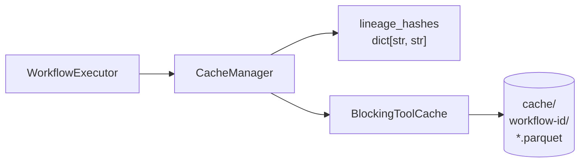

# Backend Caching System

The backend caching system persists the output of "blocking" operations to disk, avoiding expensive re-computation when users edit downstream tools in their workflows.

## The Problem: Blocking Operations

Polars uses lazy evaluation - it builds an execution plan and only materializes data when you call `.collect()`. This enables streaming: Polars can process data in chunks without loading everything into memory.

However, some operations **break streaming**. They need to see *all* rows before producing *any* output:

| Blocking Operation | Why It Blocks |
|--------------------|---------------|
| **Sort** | Must see all rows to determine final order |
| **Summarize** | Must see all rows per group to compute aggregates |
| **Join** | Must scan both sides to find matches |

When a user edits a Filter downstream of a Sort, the naive approach re-executes the entire chain from the beginning. For large datasets, the Sort operation dominates execution time - and it produces the exact same output every time (since the upstream data didn't change).

## Solution: Lineage-Based Caching

The `BlockingToolCache` persists blocking tool outputs to disk as Parquet files. When a downstream tool is edited, the executor checks if the upstream blocking tool's output is already cached.

### How Lineage Hashes Work

Each tool computes a **lineage hash** - a 16-character hex string that uniquely identifies its computation:

```python
key_data = {
    "tool_id": tool_id,        # e.g., "sort-1"
    "tool_type": tool_type,    # e.g., "Sort"
    "config": tool_config,     # e.g., {"sortColumns": [...]}
    "upstream": sorted(upstream_keys),  # Hashes from upstream tools
    "mtime": source_mtime,     # File mod time (for Input tools)
}
key_json = json.dumps(key_data, sort_keys=True, default=str)
return hashlib.sha256(key_json.encode()).hexdigest()[:16]
```

**Key insight**: The hash includes upstream hashes. This creates a hash chain where any upstream change automatically invalidates all downstream caches.

### Cache Invalidation Cascade

Consider this pipeline: `CSV -> Filter -> Sort -> Select`

1. User changes the Filter expression
2. Filter computes new lineage hash (config changed)
3. Sort computes new lineage hash (upstream key changed)
4. Sort's cache **misses** - it must re-execute
5. After Sort executes, its output is cached with the new hash
6. Select runs using the new Sort output

Now if the user changes Select's config:
1. Select computes new lineage hash
2. Sort's hash is unchanged (its config and upstream are the same)
3. Sort's cache **hits** - execution skips straight to Select
4. Select runs using the cached Sort output

## Architecture

### Components



### Key Files

| File | Purpose |
|------|---------|
| `app/server/app/domain/execution/cache_manager.py` | `CacheManager` class - caching decisions and lineage |
| `app/server/app/domain/execution/cache.py` | `BlockingToolCache` class - disk storage |
| `app/server/app/domain/execution/executor.py` | Uses `CacheManager` in `_execute_tool_with_cache` |
| `app/server/app/domain/tools/base.py` | `is_blocking()` and `should_cache()` methods |
| `app/server/app/config.py` | `cache_enabled` and `cache_path` settings |

## CacheManager

The `CacheManager` is the high-level interface for caching decisions. It wraps `BlockingToolCache` and handles lineage tracking:

```python
from app.domain.execution.cache_manager import CacheManager

cache_mgr = CacheManager(workflow_id="my-workflow-uuid", force_refresh=False)

# Check if caching is available
if cache_mgr.is_enabled:
    # Compute lineage hash for a tool
    lineage_hash = cache_mgr.compute_lineage_hash(tool, plan)
    
    # Check for cached outputs
    cached = cache_mgr.check_cache(tool, lineage_hash)
    if cached:
        outputs = cached
    else:
        outputs = await tool_impl.execute(...)
        outputs = cache_mgr.store_in_cache(tool, lineage_hash, outputs)
    
    # Always record the hash (even for non-cached tools)
    cache_mgr.record_lineage_hash(tool.id, lineage_hash)
```

### CacheManager Methods

| Method | Purpose |
|--------|---------|
| `compute_lineage_hash(tool, plan)` | Compute deterministic hash including upstream state |
| `should_cache_tool(tool)` | Check if tool's output should be cached |
| `check_cache(tool, hash)` | Return cached outputs if all sockets cached |
| `store_in_cache(tool, hash, outputs)` | Write outputs to disk, return scannable LazyFrames |
| `record_lineage_hash(tool_id, hash)` | Store hash for downstream dependency computation |
| `get_cache_stats()` | Return cache statistics |
| `clear()` | Clear all cached data for workflow |

## BlockingToolCache API

### Initialization

```python
from app.domain.execution.cache import BlockingToolCache
from pathlib import Path

cache = BlockingToolCache(
    cache_root=Path("./cache"),
    workflow_id="my-workflow-uuid"
)
# Creates: ./cache/my-workflow-uuid/
```

### Methods

#### `compute_key(tool_id, tool_type, tool_config, upstream_keys, source_mtime=None) -> str`

Compute deterministic lineage hash for a tool.

```python
lineage_hash = cache.compute_key(
    tool_id="sort-1",
    tool_type="Sort",
    tool_config={"sortColumns": [{"column": "name", "direction": "asc"}]},
    upstream_keys=["abc123def456"],  # Hashes from upstream tools
    source_mtime=None,               # Set for file inputs
)
# Returns: "7f8a9b3c2d1e4f5a" (16-char hex)
```

#### `exists(tool_id, socket_id, cache_key) -> bool`

Check if cache entry exists.

```python
if cache.exists("sort-1", "output", lineage_hash):
    # Cache hit
```

#### `get(tool_id, socket_id, cache_key) -> pl.LazyFrame | None`

Load cached result as a scannable LazyFrame.

```python
cached_lf = cache.get("sort-1", "output", lineage_hash)
if cached_lf is not None:
    # Use cached LazyFrame (backed by Parquet on disk)
```

#### `put(tool_id, socket_id, cache_key, lf: pl.LazyFrame) -> None`

Write result to cache. **This collects the LazyFrame** and writes it to disk.

```python
cache.put("sort-1", "output", lineage_hash, result_lf)
# Creates: ./cache/workflow-id/sort-1_output_7f8a9b3c2d1e4f5a.parquet
```

Uses atomic writes (temp file + rename) to prevent corruption from concurrent processes.

#### `invalidate_tool(tool_id) -> None`

Remove all cache entries for a specific tool.

```python
cache.invalidate_tool("sort-1")
# Removes: ./cache/workflow-id/sort-1_*.parquet
```

#### `clear() -> None`

Clear entire workflow cache.

```python
cache.clear()
# Removes: ./cache/workflow-id/ (entire directory)
```

#### `get_cache_stats() -> dict`

Get statistics about the cache.

```python
stats = cache.get_cache_stats()
# {
#     "workflow_id": "my-workflow-uuid",
#     "file_count": 3,
#     "total_size_bytes": 1048576,
#     "total_size_mb": 1.0
# }
```

## Tool Caching Behavior

### `is_blocking()` Method

Tools declare if they're blocking by overriding this method:

```python
class SortTool(BaseTool):
    def is_blocking(self) -> bool:
        """Sort is blocking - must see all rows to determine order."""
        return True

class FilterTool(BaseTool):
    def is_blocking(self) -> bool:
        # Default is False - Filter is not blocking
        return False
```

### `should_cache()` Method

By default, `should_cache()` returns `is_blocking()`. Override for special cases:

```python
class InputTool(BaseTool):
    def is_blocking(self) -> bool:
        """Input tools are not blocking - file inputs are lazy."""
        return False

    def should_cache(self, config: dict[str, Any]) -> bool:
        """
        Database sources should be cached to avoid repeated queries.
        File sources should NOT be cached - Polars scans them lazily.
        """
        return config.get("category") == "database"
```

### Current Caching Behavior by Tool

| Tool | `is_blocking()` | `should_cache()` | Notes |
|------|-----------------|------------------|-------|
| Sort | `True` | `True` | Always cached |
| Summarize | `True` | `True` | Always cached |
| Join | `True` | `True` | All 3 output sockets cached |
| Input (file) | `False` | `False` | Polars scans lazily |
| Input (database) | `False` | `True` | Avoid repeated DB queries |
| Filter | `False` | `False` | Streaming-compatible |
| Select | `False` | `False` | Streaming-compatible |
| Formula | `False` | `False` | Streaming-compatible |
| Union | `False` | `False` | Streaming-compatible |

## Executor Integration

The `CacheManager` handles all caching logic. The executor simply calls its methods:

```python
async def _execute_tool_with_cache(self, tool, inputs, cache_mgr, plan):
    tool_impl = ToolRegistry.get(tool.type)
    
    # 1. Compute lineage hash
    lineage_hash = cache_mgr.compute_lineage_hash(tool, plan)
    
    # 2. Check cache (only if tool should be cached)
    if cache_mgr.should_cache_tool(tool):
        cached = cache_mgr.check_cache(tool, lineage_hash)
        if cached:
            cache_mgr.record_lineage_hash(tool.id, lineage_hash)
            return cached, True  # Cache hit
    
    # 3. Execute tool
    outputs = await tool_impl.execute(tool.config, inputs)
    
    # 4. Write to cache (only if tool should be cached)
    if cache_mgr.should_cache_tool(tool):
        outputs = cache_mgr.store_in_cache(tool, lineage_hash, outputs)
    
    # 5. CRITICAL: Always record hash (even for non-cacheable tools)
    cache_mgr.record_lineage_hash(tool.id, lineage_hash)
    
    return outputs, False  # Cache miss
```

**Critical point**: Non-blocking tools (Filter, Select) still compute and store their lineage hash. This is required so downstream blocking tools can include it in their hash computation.

## Configuration

### Environment Variables / Settings

```python
# app/server/app/config.py
cache_enabled: bool = True          # Enable/disable caching globally
cache_path: str = "./cache"         # Root directory for all workflow caches
```

### API Parameters

The `force_refresh` parameter on execute endpoints clears the workflow cache before execution:

```python
# POST /api/workflow/execute
{
    "workflow": {...},
    "force_refresh": true  # Clear cache, re-execute everything
}
```

This is useful for:
- Database inputs where source data may have changed
- Debugging cache-related issues
- Forcing re-computation after external file changes

## File System Layout

```
cache/
├── workflow-uuid-1/
│   ├── sort-1_output_abc123.parquet
│   ├── join-1_output_left_def456.parquet
│   ├── join-1_output_match_def456.parquet
│   └── join-1_output_right_def456.parquet
├── workflow-uuid-2/
│   └── summarize-1_output_ghi789.parquet
└── ...
```

File naming: `{tool_id}_{socket_id}_{lineage_hash}.parquet`

Socket IDs with hyphens are sanitized (e.g., `output-left` becomes `output_left`).

## Gotchas and Edge Cases

### 1. Multi-Socket Tools (Join)

Join has 3 output sockets. The cache checks that **all sockets** are cached before returning a hit:

```python
output_sockets = [s.id for s in tool.sockets if s.direction == "output"]
all_cached = all(
    self.cache.exists(tool.id, sid, lineage_hash)
    for sid in output_sockets
)
```

If any socket is missing, the entire tool re-executes.

### 2. Cache Read Failures

If a cache file is corrupted, `get()` logs a warning, deletes the file, and returns `None` (triggering re-execution):

```python
def get(self, tool_id, socket_id, cache_key):
    path = self.cache_path(tool_id, socket_id, cache_key)
    if path.exists():
        try:
            return pl.scan_parquet(path)
        except Exception as e:
            logger.warning(f"Failed to read cache file {path}: {e}")
            path.unlink(missing_ok=True)
            return None
    return None
```

### 3. Concurrent Writes

Uses atomic write pattern to prevent corruption:

```python
temp_path = final_path.with_suffix(".tmp")
df.write_parquet(temp_path)
os.replace(temp_path, final_path)  # Atomic on POSIX and Windows
```

### 4. Orphaned Temp Files

On initialization, the cache cleans up any `.tmp` files from interrupted writes:

```python
for orphan in self.cache_dir.glob("*.tmp"):
    orphan.unlink(missing_ok=True)
```

### 5. Hash Chain Dependency

Non-blocking tools **must** store their lineage hash even though their outputs aren't cached. Without this, downstream blocking tools can't compute a proper hash:

```
CSV (hash: aaa) -> Filter (hash: bbb) -> Sort (needs bbb to compute its hash)
```

If Filter doesn't store its hash, Sort's `upstream_keys` would be empty, and changing the Filter expression wouldn't invalidate Sort's cache.

## Performance Considerations

### When Caching Helps

- Large datasets with expensive blocking operations upstream
- Interactive editing of downstream tools
- Database inputs that are slow to query
- Workflows with multiple downstream branches from a blocking tool

### When Caching Doesn't Help

- Small datasets where execution is already fast
- Editing the blocking tool itself (cache will miss)
- First execution of a workflow (nothing cached yet)
- Workflows with only streaming operations (no blocking tools)

### Memory vs. Disk Trade-off

The cache writes to disk (Parquet format), which:
- **Pros**: Persists across sessions, doesn't consume RAM
- **Cons**: I/O overhead, disk space usage

For very large datasets, the cache can consume significant disk space. Use `get_cache_stats()` to monitor usage.

### Polars Query Optimization

**Note**: Polars may attempt predicate pushdown to reorder filters before expensive operations in some cases, but this optimization is not guaranteed and has been observed to be inconsistent. Workflow structure and cache invalidation logic assume operations execute in the order defined by the workflow graph, not in an optimized order.

This means:
- Users should structure workflows assuming literal execution order
- Cache keys are computed based on workflow order, not optimized order
- Performance advice should not rely on automatic optimization

## Testing

Cache behavior is tested in `app/server/tests/test_cache.py`:

```bash
cd app && ./scripts/test.py -k test_cache
```

Key test classes:
- `TestBlockingToolCache` - Basic CRUD operations
- `TestBlockingToolCacheEdgeCases` - Isolation, empty upstream, mtime handling
- `TestToolCachingBehavior` - `is_blocking()` and `should_cache()` per tool
