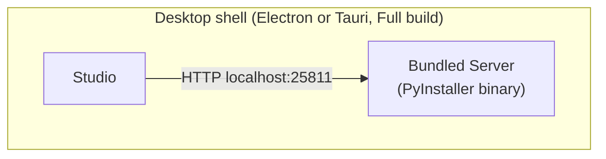
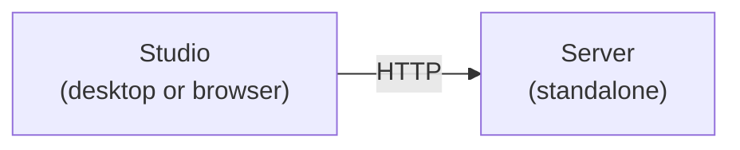
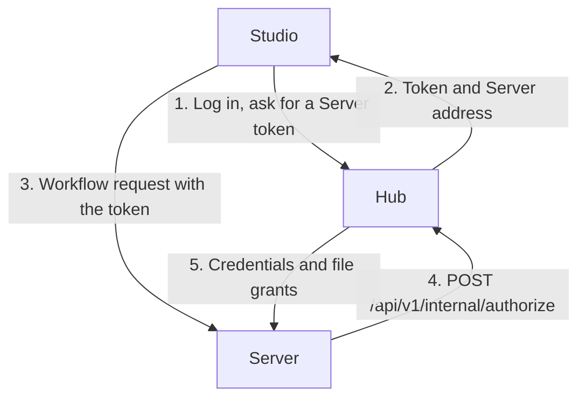
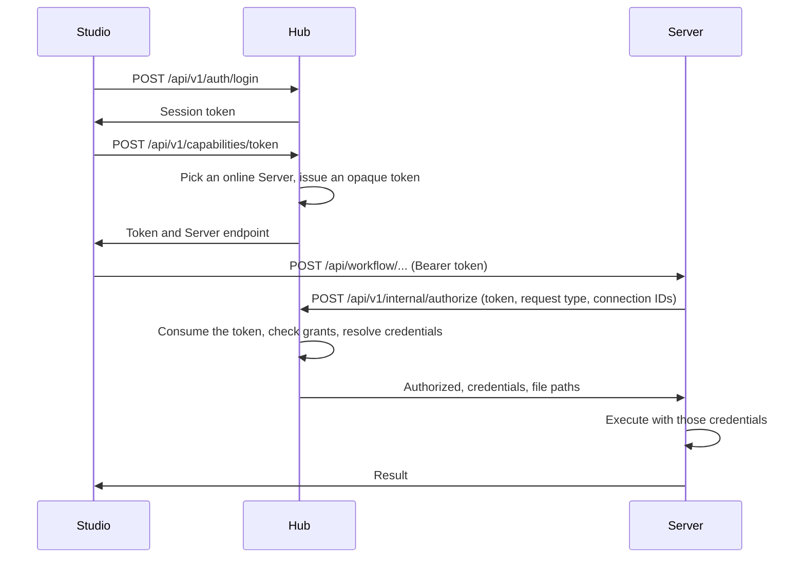
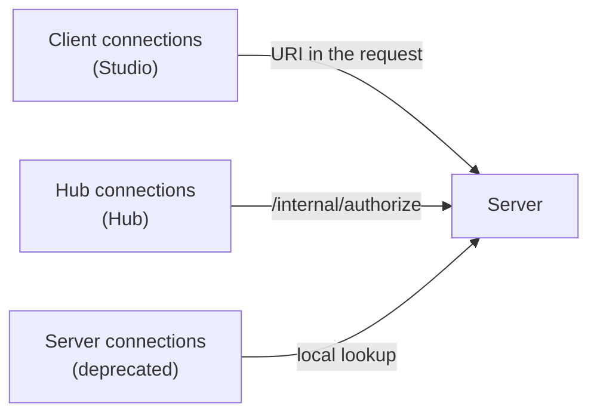

# Component Relationships

How **Studio**, **Server** and **Hub** interact in each deployment mode.

## Components

| Component | Purpose | Stack | Default port |
| --------- | ------- | ----- | ------------ |
| **Studio** | Visual workflow designer | React, Xyflow, Vite; Electron, Tauri or browser | 25810 (dev server) |
| **Server** | Workflow execution engine | Python, FastAPI, Polars | 25811 |
| **Hub** | Team orchestration platform | FastAPI, React, PostgreSQL | 25802 (API and web app), 25803 (dev frontend) |

Ports follow a `258xx` pattern. PostgreSQL uses 25801 in development, and the docs dev server uses 25809.

## Execution modes

Studio's **Settings > Execution** chooses one of three modes (`executionMode` in the settings):

| Mode | Meaning | Use case |
| ---- | ------- | -------- |
| `bundled` | The desktop shell runs a Server that ships inside the app | One person, one machine |
| `external` | Studio talks directly to a Server you run | Development, self-hosted |
| `hub` | Studio gets a token from Hub, then talks to a Server that Hub picks | Teams |

## Mode 1: Bundled Server



Both desktop shells come in a **Full** variant that bundles the Server and a **Client** variant that does not. Electron ships the Server binary as an extra resource. Tauri ships it as a sidecar. The Tauri Full build is selected at compile time by the `bundled-server` Cargo feature. The [Packaging](../building/packaging.md) page has the build details.

How it works:

1. On launch, the shell starts the Server and injects a random session token (`AUTH_MODE=ephemeral`, `SESSION_TOKEN=<token>`) plus writable data paths.
2. The shell waits for `/api/health/`.
3. Studio sends workflows to `http://localhost:25811` with the token.
4. On exit, the shell stops the Server.

Studio's defaults for this mode:

```typescript
{ executionMode: 'bundled', backend: { url: 'http://localhost:25811', autoStart: true, previewRows: 100 } }
```

Client connections are stored in the operating system's credential store: Electron `safeStorage` or the Tauri `keyring` crate.

## Mode 2: External Server



The user sets the Server URL in Studio. The Server's `AUTH_MODE` decides what Studio must present:

| `AUTH_MODE` | Studio needs |
| ----------- | ------------ |
| `disabled` | Nothing. Development only. |
| `static` | The token that the Server has in `SESSION_TOKEN` |
| `ephemeral` | The token the Server generated at startup (or that `SESSION_TOKEN` sets) |

Configuration of the Server side is in [Server Configuration](../../admin/server-configuration.md).

## Mode 3: Hub





Details of the current implementation:

- **Server tokens** are random opaque IDs kept in a token store (memory by default, PostgreSQL optionally). A token records the user and the Server it is for. It is single-use and expires after `SERVER_TOKEN_TTL_SECONDS` (300 by default).
- Studio asks for a fresh token for **each request**, because each one is consumed when the Server authorizes it.
- The Server authenticates to Hub's internal endpoint with its own `HUB_SERVER_TOKEN`, which is the identity Hub registered for it.
- Hub picks the Server. With no preference it chooses the least-loaded online Server (fewest queued or running executions, ties random).
- Hub logs `capability.token_issued` and `authorize.*` events in its hash-chained audit log.
- The Server registers with Hub, and re-registers every 30 seconds, when `HUB_URL` and `HUB_SERVER_TOKEN` are set. See [Server Management](../../admin/servers.md).

Hub can also run workflows itself, for schedules and for the **Run Now** button in its web app. It calls `POST /api/workflow/execute` on a Server directly, as the triggering user (manual runs) or the schedule creator (scheduled runs). See [Hub Architecture](./hub.md) and [Hub Open Beta](../../admin/hub-beta.md).

Studio's settings for this mode:

```typescript
{ executionMode: 'hub', hub: { url: 'https://hub.example.com', rememberLogin: true, sessionToken: '...' } }
```

## Connection ownership

| Owner | Stored in | Managed by | Notes |
| ----- | --------- | ---------- | ----- |
| **client** | The OS credential store on the user's machine | The user, in Studio | Credentials are sent to the Server with each request that needs them |
| **hub** | Hub's database, encrypted | Hub administrators | The Server fetches credentials from Hub at request time |
| **server** | `connections.json` on the Server | A Server administrator | Deprecated. Prefer Hub connections |



## Security by mode

| Aspect | Bundled | External | Hub |
| ------ | ------- | -------- | --- |
| Authentication | Per-launch token | Static token, per-launch token or none | Hub session, then single-use Server token |
| Credential storage | OS credential store | OS credential store (client) | Hub database (encrypted) |
| Access control | Single user | None beyond the token | Roles, groups and grants |
| Audit | Server request log | Server request log | Hub audit log plus Server request log |

## When to use each mode

| Mode | Best for |
| ---- | -------- |
| Bundled | Individuals, desktop work, offline work |
| External | Developers, a single shared Server |
| Hub | Teams, several environments, shared credentials |

## See also

- [Server Configuration](../../admin/server-configuration.md)
- [Hub Architecture](./hub.md)
- [Security Model](../../admin/security.md)
