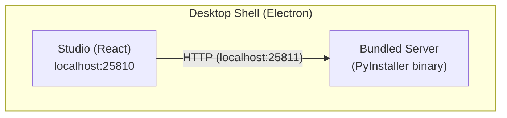
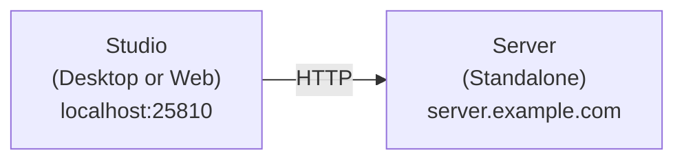
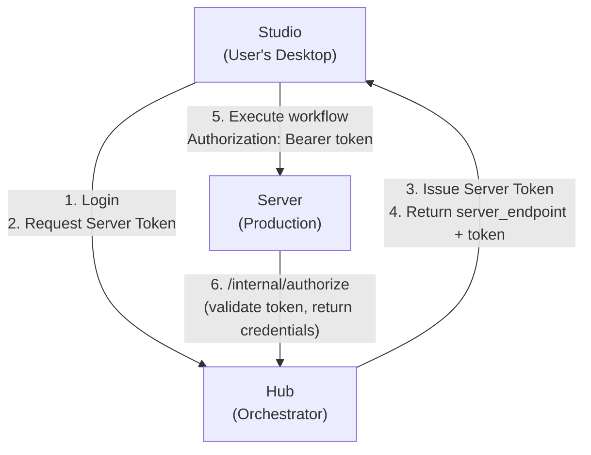
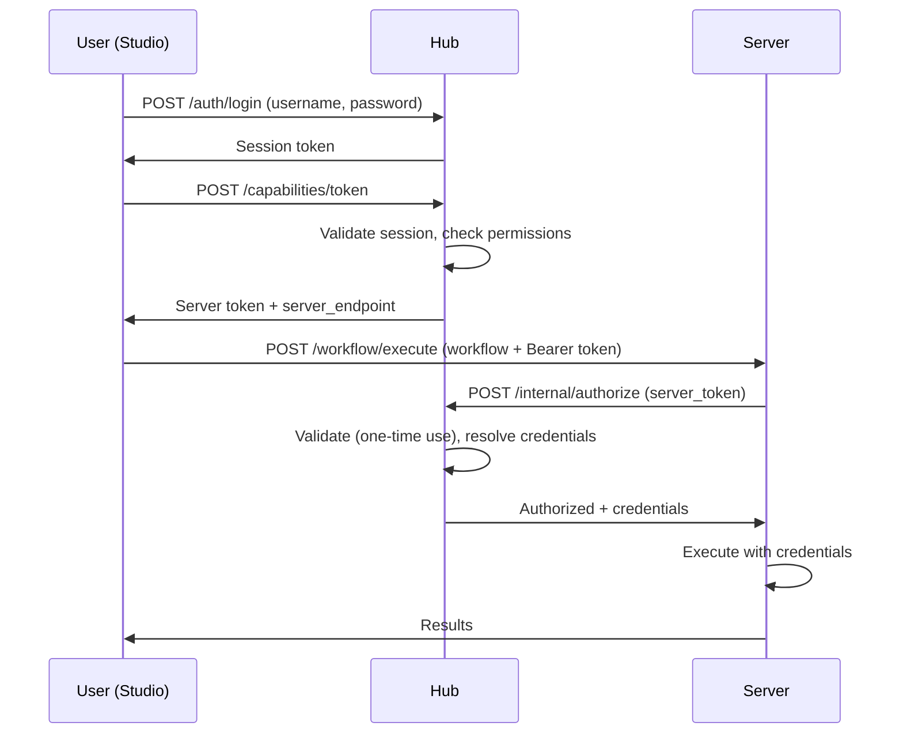
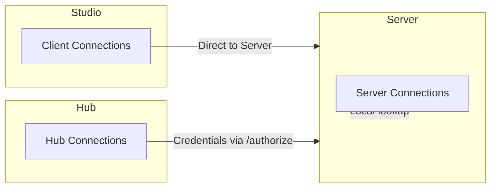

# Component Relationships

This document outlines how Sigilweaver's three main components—**Studio**, **Server**, and **Hub**—interact across different deployment scenarios.

## Component Overview

| Component  | Purpose                                | Tech Stack                       | Default Port |
| ---------- | -------------------------------------- | -------------------------------- | ------------ |
| **Studio** | Visual workflow designer (desktop app) | React, Xyflow, Electron or Tauri | 25810        |
| **Server** | Workflow execution engine              | Python, FastAPI, Polars          | 25811        |
| **Hub**    | Multi-user orchestration platform      | FastAPI + React                  | 25802/25803  |

## Execution Modes

Studio supports three execution modes, configured in **Settings > Connection**:

| Mode       | Description                            | Use Case                 |
| ---------- | -------------------------------------- | ------------------------ |
| `bundled`  | Server runs inside desktop shell       | Single user, desktop     |
| `external` | Direct connection to standalone Server | Development, self-hosted |
| `hub`      | Hub mediates all Server communication  | Teams, multi-server      |

---

## Mode 1: Bundled Server (Desktop)

**Scenario**: Single user running the full desktop application.



:::info Desktop Shell Options
Sigilweaver Studio supports two desktop shells:
- **Electron** (Full build): Bundles the Server executable and manages its lifecycle
- **Tauri** (Client build): Lightweight shell that connects to an external Server

The bundled server mode is only available with Electron. Tauri builds operate in `external` mode.
:::

### How It Works

1. **Startup**: Desktop shell spawns the bundled Server executable
2. **Authentication**: Ephemeral token generated per session
3. **Execution**: Studio sends workflows directly to localhost:25811
4. **Shutdown**: Server terminates when Studio closes

### Key Characteristics

- **Self-contained**: No external dependencies
- **Ephemeral auth**: Random UUID token generated each launch
- **Auto-start**: Controlled by `backend.autoStart` setting
- **Credentials local**: Database connections stored in OS secure storage (Keychain, DPAPI, Secret Service)

### Configuration

```typescript
// Studio settings (default for bundled)
{
  executionMode: 'bundled',
  backend: {
    url: 'http://localhost:25811',
    autoStart: true
  }
}
```

```bash
# Server environment (set by desktop shell)
AUTH_MODE=ephemeral
SESSION_TOKEN=<generated-uuid>
```

---

## Mode 2: External Server (Direct Connection)

**Scenario**: Developer running Server separately, or connecting to a remote Server.



### How It Works

1. **User configures**: Server URL in Studio settings
2. **Direct connection**: Studio calls Server API directly
3. **Auth options**: Token-based or disabled (development)
4. **Credentials**: Managed on Server via `connections.json`

### Key Characteristics

- **Flexible deployment**: Server can run anywhere (local, VM, cloud)
- **Direct API access**: No intermediary
- **Manual credential management**: Server admin manages `connections.json`
- **Multiple auth modes**: `disabled`, `static` (env token), or `ephemeral`

### Configuration

```typescript
// Studio settings
{
  executionMode: 'external',
  backend: {
    url: 'https://server.example.com',
    autoStart: false  // Irrelevant for external
  }
}
```

```bash
# Server environment options

# Development (no auth)
AUTH_MODE=disabled

# Static token (shared secret)
AUTH_MODE=static
SESSION_TOKEN=your-shared-secret

# Ephemeral (for automated deployment)
AUTH_MODE=ephemeral
SESSION_TOKEN=<generated-at-deploy>
```

---

## Mode 3: Hub-Mediated

**Scenario**: Team environment with centralized access control and multiple servers.



### Authentication Flow



### Key Characteristics

- **Centralized auth**: Users authenticate with Hub, not Server
- **RBAC**: Role-based access control (Owner, Admin, Auditor, User)
- **Credential isolation**: Credentials never leave Hub → Server path
- **Multi-server**: Hub routes to multiple Servers (dev, staging, prod)
- **One-time tokens**: Server tokens are consumed on authorize
- **Audit trail**: All operations logged in Hub

### Server Token Flow

1. **Studio → Hub**: Request token (user must be logged in)
2. **Hub**: Validates session, picks healthy server, issues token
3. **Hub → Studio**: Returns opaque token + server endpoint
4. **Studio → Server**: Sends request with token in Authorization header
5. **Server → Hub**: Calls `/internal/authorize` with token
6. **Hub**: Validates token, checks permissions, returns credentials
7. **Hub → Server**: Credentials for hub-owned connections
8. **Server**: Executes workflow with resolved credentials

### Configuration

```typescript
// Studio settings
{
  executionMode: 'hub',
  hub: {
    url: 'https://hub.example.com',
    rememberLogin: true,
    sessionToken: '<persisted-if-remember>'
  }
}
```

```bash
# Server environment (Hub-connected)
AUTH_MODE=hub
HUB_URL=https://hub.example.com
HUB_SERVER_TOKEN=<token-from-hub-registration>
HUB_REGISTRATION_SECRET=<shared-secret>
```

```bash
# Hub environment
DATABASE_URL=postgresql://...
SECRET_KEY=<jwt-secret>
SERVER_REGISTRATION_SECRET=<shared-secret>
```

---

## Connection Ownership

Connections (database credentials, file paths) can be owned by different components:

| Owner      | Location                     | Managed By             | Visible To                      |
| ---------- | ---------------------------- | ---------------------- | ------------------------------- |
| **Client** | OS secure storage            | User (Studio settings) | This Studio instance only       |
| **Server** | `connections.json` on Server | Server admin           | All Studio users of that Server |
| **Hub**    | Hub database (encrypted)     | Hub admin              | Users with granted access       |

### In Hub Mode



- **Client connections**: Sent with each request (encrypted in transit)
- **Server connections**: Looked up locally by ID
- **Hub connections**: Server calls Hub to get credentials just-in-time

---

## Port Scheme

All Sigilweaver ports follow the `258xx` pattern (founding date: 2025-08-01):

| Port  | Component    | Notes           |
| ----- | ------------ | --------------- |
| 25802 | Hub Backend  | API server      |
| 25803 | Hub Frontend | Web UI (dev)    |
| 25810 | Studio       | Vite dev server |
| 25811 | Server       | Default backend |

---

## Security Model by Mode

| Aspect                 | Bundled                 | External             | Hub                        |
| ---------------------- | ----------------------- | -------------------- | -------------------------- |
| **Auth Type**          | Ephemeral (per-session) | Static/Disabled      | Session + Server tokens    |
| **Token Lifetime**     | App lifetime            | Permanent            | Configurable (e.g., 5 min) |
| **Credential Storage** | OS secure storage       | Server filesystem    | Hub database (encrypted)   |
| **Access Control**     | Single user             | Manual               | RBAC                       |
| **Audit**              | Local only              | Server-side optional | Hub-centralized            |

---

## When to Use Each Mode

| Mode         | Best For                                              |
| ------------ | ----------------------------------------------------- |
| **Bundled**  | Individual users, desktop workflows, offline work     |
| **External** | Developers testing, simple single-server deployments  |
| **Hub**      | Teams, multiple environments, compliance requirements |

---

## See Also

- [Server Configuration](../../admin/server-configuration.md)
- [Architecture Overview](./overview.md)
- [Hub Architecture](./hub.md)
