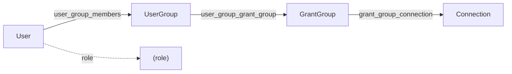

# Hub Architecture

Hub is the orchestration platform for team deployments. It manages user authentication, access control, workflow storage, and execution scheduling.

## Technology Stack

| Layer | Technology | Why |
|-------|------------|-----|
| Backend | FastAPI | Async, OpenAPI docs, dependency injection |
| Database | PostgreSQL | ACID compliance, JSON support, proven |
| ORM | SQLAlchemy 2.0 | Async support, type hints, migrations |
| Frontend | React + Vite | Fast dev experience, modern tooling |
| State | Zustand | Simple, no boilerplate, TypeScript-first |

## Directory Structure

```
hub/
├── backend/
│   ├── app/
│   │   ├── api/
│   │   │   ├── routes/           # HTTP endpoints
│   │   │   │   ├── auth.py       # Login, register, sessions
│   │   │   │   ├── users.py      # User CRUD
│   │   │   │   ├── groups.py     # User group management
│   │   │   │   ├── grant_groups.py  # Grant group management
│   │   │   │   ├── connections.py   # Connection CRUD
│   │   │   │   └── servers.py    # Server registration
│   │   │   └── dependencies.py   # Auth dependencies
│   │   ├── db/
│   │   │   ├── models.py         # SQLAlchemy models
│   │   │   ├── database.py       # Session management
│   │   │   └── migrations/       # Alembic migrations
│   │   └── domain/
│   │       ├── audit/             # Audit trail logging
│   │       ├── auth/              # Authentication logic
│   │       ├── capabilities/      # Feature capability checks
│   │       ├── connections/       # Credential encryption
│   │       ├── executions/        # Workflow execution management
│   │       ├── schedules/         # Execution scheduling
│   │       ├── servers/           # Server registration and management
│   │       └── workflows/         # Workflow storage and versioning
│   └── tests/
│       ├── test_grant_group_routes.py
│       ├── test_grant_group_permissions.py
│       └── test_connections/
├── frontend/
│   └── src/
│       ├── api/client.ts         # API client
│       ├── components/           # Shared components
│       ├── pages/admin/          # Admin UI
│       └── state/                # Zustand stores
└── docker-compose.yml
```

## Permission Hierarchy

Hub implements a unidirectional permission hierarchy. Access flows in one direction only:

```
Users → User Groups → Grant Groups → Connections
```

### Data Model



### Database Tables

| Table | Purpose |
|-------|---------|
| `users` | User accounts with roles |
| `groups` | User groups for organizing users |
| `user_groups` | Junction: users ↔ groups |
| `grant_groups` | Permission bundles containing connections |
| `user_group_grant_groups` | Junction: groups ↔ grant groups |
| `grant_group_connections` | Junction: grant groups ↔ connections |

### Why This Design?

**Single audit path**: To answer "why does user X have access to connection Y?", trace:
```
User → UserGroup membership → GrantGroup assignment → Connection assignment
```

**No cycles possible**: Grant Groups cannot reference other Grant Groups or Users directly. This prevents circular permission dependencies.

**Reusable permission bundles**: A single Grant Group (e.g., "Production Databases") can be assigned to multiple User Groups without duplicating connection assignments.

**Clear separation of concerns**:
- User Groups = organizational structure (teams, departments)
- Grant Groups = permission bundles (what resources)
- Connections = actual resources

## Access Control Implementation

### Checking User Access to Connections

```python
# hub/backend/app/api/routes/connections.py

async def list_connections(user: SessionInfo, db: AsyncSession):
    # Admins/auditors see all
    if user.role in ("owner", "admin", "auditor"):
        return await store.list_connections()
    
    # Users: trace through the hierarchy
    # 1. Get user's groups
    user_group_ids = await get_user_group_ids(db, user.user_id)
    
    # 2. Get grant groups assigned to those user groups
    grant_group_ids = await db.execute(
        select(UserGroupGrantGroup.grant_group_id)
        .where(UserGroupGrantGroup.user_group_id.in_(user_group_ids))
    )
    
    # 3. Get connections in those grant groups
    accessible_ids = await db.execute(
        select(GrantGroupConnection.connection_id)
        .where(GrantGroupConnection.grant_group_id.in_(grant_group_ids))
    )
    
    return [c for c in connections if c.id in accessible_ids]
```

### Route Dependencies

```python
# Require specific roles
from app.api.dependencies import RequireAdmin, RequireAuditor

@router.post("/grant-groups")
async def create_grant_group(
    request: GrantGroupCreate,
    _admin: SessionInfo = RequireAdmin,  # 403 if not admin
    db: AsyncSession = Depends(get_db),
):
    ...

@router.get("/grant-groups")
async def list_grant_groups(
    _user: SessionInfo = RequireAuditor,  # Admin or auditor
    db: AsyncSession = Depends(get_db),
):
    ...
```

## API Endpoints

### Grant Groups

| Method | Endpoint | Role | Description |
|--------|----------|------|-------------|
| GET | `/grant-groups` | Auditor+ | List all grant groups |
| POST | `/grant-groups` | Admin | Create grant group |
| GET | `/grant-groups/{id}` | Auditor+ | Get grant group with connections and user groups |
| PATCH | `/grant-groups/{id}` | Admin | Update grant group |
| DELETE | `/grant-groups/{id}` | Admin | Delete grant group |
| POST | `/grant-groups/{id}/connections/{conn_id}` | Admin | Add connection to grant group |
| DELETE | `/grant-groups/{id}/connections/{conn_id}` | Admin | Remove connection from grant group |
| GET | `/grant-groups/{id}/user-groups` | Auditor+ | List user groups with this grant group (read-only) |

### User Groups (Grant Group Assignment)

| Method | Endpoint | Role | Description |
|--------|----------|------|-------------|
| GET | `/groups/{id}/grant-groups` | Auditor+ | List grant groups assigned to user group |
| POST | `/groups/{id}/grant-groups/{gg_id}` | Admin | Assign grant group to user group |
| DELETE | `/groups/{id}/grant-groups/{gg_id}` | Admin | Remove grant group from user group |

### Design Decision: Unidirectional Assignment

Grant groups are assigned **from the User Groups side**, not from the Grant Groups side. This enforces the parent → child hierarchy:

```
POST /groups/{group_id}/grant-groups/{grant_group_id}   # Correct
POST /grant-groups/{grant_group_id}/user-groups/{group_id}  # Not implemented
```

The Grant Groups tab shows which user groups reference it (read-only). To modify assignments, use the User Groups tab.

## Testing

### Test Structure

```
hub/backend/tests/
├── test_grant_group_routes.py      # CRUD and assignment operations
├── test_grant_group_permissions.py # Access control verification
└── test_connections/
    ├── test_user_connections.py    # User role access tests
    ├── test_admin_connections.py   # Admin role tests
    └── test_auditor_connections.py # Auditor role tests
```

### Key Test Patterns

```python
# Test that users can only see connections via grant groups
async def test_user_can_list_connections_via_grant_group(client, db):
    # Setup: user → user_group → grant_group → connection
    user = await create_user(db, role="user")
    group = await create_group(db)
    await add_user_to_group(db, user.id, group.id)
    
    grant_group = await create_grant_group(db)
    await assign_grant_group_to_group(db, group.id, grant_group.id)
    
    connection = await create_connection(db)
    await add_connection_to_grant_group(db, grant_group.id, connection.id)
    
    # Test: user can see the connection
    response = await client.get("/connections", headers=auth_headers(user))
    assert response.status_code == 200
    assert connection.id in [c["id"] for c in response.json()["connections"]]
```

### Running Tests

```bash
cd hub/backend

# All grant group tests
uv run pytest tests/test_grant_group_routes.py tests/test_grant_group_permissions.py -v

# Connection access tests
uv run pytest tests/test_connections/ -v

# Full test suite
uv run pytest -v
```

## Frontend Implementation

### State Management

The frontend uses Zustand stores with separate concerns:

```typescript
// src/state/authStore.ts - Authentication state
// src/state/settingsStore.ts - UI preferences
```

### API Client

```typescript
// src/api/client.ts

// Grant Groups
export async function listGrantGroups(): Promise<GrantGroupListResponse>;
export async function createGrantGroup(data: GrantGroupCreate): Promise<GrantGroupSummary>;
export async function getGrantGroup(id: string): Promise<GrantGroupDetail>;
export async function addConnectionToGrantGroup(grantGroupId: string, connectionId: string): Promise<void>;

// User Group → Grant Group assignment
export async function listGroupGrantGroups(groupId: string): Promise<GroupGrantGroupsResponse>;
export async function assignGrantGroupToGroup(groupId: string, grantGroupId: string): Promise<void>;
export async function removeGrantGroupFromGroup(groupId: string, grantGroupId: string): Promise<void>;
```

### UI Components

| Component | Location | Purpose |
|-----------|----------|---------|
| `DashboardTab` | `pages/admin/DashboardTab.tsx` | Overview dashboard |
| `UsersTab` | `pages/admin/UsersTab.tsx` | Manage users |
| `GroupsTab` | `pages/admin/GroupsTab.tsx` | Manage user groups, assign grant groups |
| `GrantGroupsTab` | `pages/admin/GrantGroupsTab.tsx` | Manage grant groups, assign connections |
| `ConnectionsTab` | `pages/admin/ConnectionsTab.tsx` | Manage connections |
| `ServersTab` | `pages/admin/ServersTab.tsx` | Manage registered servers |
| `ActivityTab` | `pages/admin/ActivityTab.tsx` | View audit trail and activity |
| `SettingsPage` | `pages/admin/SettingsPage.tsx` | Hub settings |
| `SettingsPage` | `pages/admin/SettingsPage.tsx` | Hub settings |

The sidebar follows the hierarchy: Users → User Groups → Grant Groups → Connections
