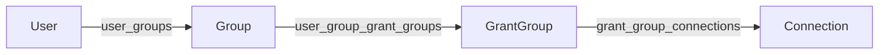

# Hub Architecture

Hub is the platform for team deployments. It manages accounts and roles, shared connections, workflow storage, schedules and an audit log, and it authorizes what Servers do on a user's behalf. Hub is in **open beta**. See [Hub Open Beta](../../admin/hub-beta.md) for its limits.

## Technology stack

| Layer | Technology | Why |
| ----- | ---------- | --- |
| Backend | FastAPI | Async, OpenAPI docs, dependency injection |
| Database | PostgreSQL with SQLAlchemy 2.0 (async) | ACID, migrations with Alembic |
| Scheduling | APScheduler (in process) | Cron schedules without another service |
| Frontend | React with Vite and Zustand | Same patterns as Studio |
| Password hashing | Argon2id | Memory-hard hashing |
| Credential encryption | Fernet (`cryptography`) | Authenticated symmetric encryption |

## Directory structure

```
hub/
|-- backend/
|   |-- app/
|   |   |-- main.py               App, startup checks, background tasks
|   |   |-- config.py             Settings (environment variables)
|   |   |-- api/
|   |   |   |-- dependencies.py   CurrentUser, RequireUser, RequireAdmin, RequireAuditor
|   |   |   `-- v1/routes/        auth, users, groups, grant_groups, connections,
|   |   |                         servers, workflows, executions, schedules,
|   |   |                         capabilities, internal, audit, health
|   |   |-- db/
|   |   |   |-- models.py         SQLAlchemy models
|   |   |   `-- migrations/       Alembic versions
|   |   |-- domain/
|   |   |   |-- auth/             passwords, roles, sessions, server-token store
|   |   |   |-- capabilities/     Issues Server tokens
|   |   |   |-- connections/      Encrypted store, health poller
|   |   |   |-- servers/          Server client, health poller
|   |   |   |-- workflows/        File store, parser, revisions
|   |   |   |-- executions/       Service, in-memory event broker
|   |   |   |-- schedules/        Scheduler and service
|   |   |   |-- artifacts/        Content-addressed output storage
|   |   |   `-- audit/            Hash-chained audit events
|   |   `-- middleware/           Rate limiting
|   |-- scripts/                  Dev seed scripts
|   `-- tests/
`-- frontend/
    `-- src/
        |-- pages/                User pages, plus pages/admin/ for administrators
        |-- components/           Layout, route guards, schedule builder
        |-- api/client.ts         API client
        `-- state/                Auth and settings stores
```

## API

All routes are under `/api/v1`. `GET /api/v1/health` needs no authentication. Every other route needs a session (`Authorization: Bearer <session token>`), except registration of the first account and login. Interactive docs are served at `/docs`.

| Resource | Routes | Roles |
| -------- | ------ | ----- |
| Auth | `/auth/register`, `/auth/login`, `/auth/logout`, `/auth/me`, `/auth/status` | Public, then any user |
| Users | `/users` and `/users/{id}` (with `/groups`) | Auditor reads, Admin writes (within role rules) |
| User groups | `/groups`, `/groups/{id}/members`, `/groups/{id}/grant-groups` | Auditor reads, Admin writes |
| Grant groups | `/grant-groups`, `/grant-groups/{id}/connections`, `/grant-groups/{id}/user-groups` | Auditor reads, Admin writes |
| Connections | `/connections`, `/connections/{id}/check`, `/connections/test` | Admin |
| Servers | `/servers`, `/servers/{id}/refresh`, `/servers/{id}/groups` | Admin writes, Auditor reads, self-registration by secret |
| Workflows | `/workflows`, `/workflows/{id}/content`, `/download`, `/revisions`, `/diff` | User owns, Admin deletes, Auditor reads |
| Executions | `/executions`, `/executions/stream`, `/executions/{id}/cancel`, `/artifacts`, and auditor-only `/record`, `/code`, `/plans`, `/connections`, `/logs` | User creates and reads own |
| Schedules | `/schedules`, `/schedules/{id}/toggle`, `/schedules/{id}/trigger` | User owns |
| Capabilities | `POST /capabilities/token` | Any authenticated user |
| Internal | `POST /internal/authorize` | Servers (by their `auth_token`) |
| Audit | `/audit/events`, `/audit/verify` | Auditor and above |

## Permission model

Access to connections flows one way:

```
Users -> User Groups -> Grant Groups -> Connections
```



| Table | Purpose |
| ----- | ------- |
| `users` | Accounts, with a role |
| `groups` | User groups |
| `user_groups` | Junction: users and groups |
| `grant_groups` | Reusable permission bundles |
| `user_group_grant_groups` | Junction: groups and grant groups |
| `grant_group_connections` | Junction: grant groups and connections |
| `connections`, `connection_databases`, `connection_filesystems` | Connection metadata and type-specific settings, with encrypted credentials |
| `servers`, `server_groups` | Registered Servers, and which groups can see them |
| `workflows`, `workflow_revisions` | Workflow metadata, and stored revisions |
| `executions`, `execution_records`, `execution_artifacts` | Runs, their audit records and stored outputs |
| `schedules` | Cron schedules |
| `sessions`, `server_tokens` | Login sessions, and Server tokens when `TOKEN_STORE_BACKEND=postgres` |
| `audit_events` | The hash-chained audit log |

A single audit path answers "why can user X use connection Y?". Grant groups cannot contain grant groups or users, so cycles are impossible. Assignments are made from the user-group side only. The grant-group side shows them read-only.

### Roles

`domain/auth/roles.py` defines `owner`, `admin`, `auditor` and `user` with a hierarchy. Route dependencies in `api/dependencies.py`:

| Dependency | Allows |
| ---------- | ------ |
| `CurrentUser` | Any valid session |
| `RequireAuditor` | Owner, Admin, Auditor |
| `RequireAdmin` | Owner, Admin |
| `RequireUser` | The `user` role only (not Admin or Owner) |

```python
@router.post("/grant-groups")
async def create_grant_group(
    request: GrantGroupCreate,
    admin: SessionInfo = RequireAdmin,
    db: AsyncSession = Depends(get_db),
): ...
```

`can_manage_role` and `can_assign_role` implement who may create, edit and delete whom. See [Roles and Permissions](../../admin/roles.md).

## Authorization flow

Studio requests a token at `POST /capabilities/token`. `CapabilityIssuer` picks an online Server, creates an opaque token in the token store (`memory` or `postgres`) with the user ID, the Server ID and a TTL, and returns it with the Server's endpoint. When the Server calls `POST /internal/authorize`, Hub authenticates the Server by its `auth_token`, atomically consumes the token, checks the user's grants for every requested connection, resolves the credentials and file paths, and writes an audit event. See [Component Relationships](./component-relationships.md).

## Background work

Everything below runs inside the Hub process, started in the app's lifespan hook in `main.py`:

| Task | Does |
| ---- | ---- |
| Server health poller | Checks every Server each `SERVER_POLL_INTERVAL_SECONDS`, with backoff and an offline threshold |
| Connection health poller | Tests every connection about hourly |
| Scheduler | APScheduler polls due database occurrences every second; a schedule row lock serializes occurrence advancement and execution insertion |
| Session cleanup | Deletes expired sessions in batches |
| Token store cleanup | Drops expired in-memory tokens |
| Execution tasks | One `asyncio` task per execution, started by `ExecutionService.trigger_execution`; heartbeat every 15 seconds |
| Execution recovery | Startup and 60-second sweeps mark stale queued/running records failed; runners are cancelled on shutdown |
| Event broker | In-memory fan-out of execution events to Server-Sent Events clients |

Execution records and next schedule occurrences survive in PostgreSQL. A dispatcher locks a due schedule with `FOR UPDATE SKIP LOCKED`, uses the database clock, and advances its next occurrence in the same transaction that inserts the execution. A failed uncommitted claim can be retried by another process; overdue intervals are coalesced into one attempt. This prevents duplicate schedule dispatch, but does not make the execution runner durable: a restarted Hub marks stale records failed and cannot resume their Server requests. The in-memory event broker and default token store still require one Hub replica.

## Frontend

The Hub frontend is a Vite React app served by the backend in production (`STATIC_FILES_PATH`). Users see Home, Workflows, Executions and Schedules. Auditors and above see an admin area.

| Page | File |
| ---- | ---- |
| Dashboard | `pages/admin/DashboardTab.tsx` |
| Activity | `pages/admin/ActivityTab.tsx` |
| Audit Log | `pages/admin/AuditTab.tsx` |
| Servers | `pages/admin/ServersTab.tsx` |
| Users, User Groups, Grant Groups | `UsersTab.tsx`, `GroupsTab.tsx`, `GrantGroupsTab.tsx` |
| Connections | `pages/admin/ConnectionsTab.tsx` |
| Settings | `pages/admin/SettingsPage.tsx` (a placeholder) |

`api/client.ts` re-exports typed endpoint functions from resource modules in `api/`. `state/authStore.ts` keeps the session. There are three themes (Sigilweaver, Dark and Light) driven by semantic CSS variables.

## Testing

Backend tests are in `hub/backend/tests/`, grouped by area: authentication and roles, connections and permissions per role, servers, workflows, schedules, executions, artifacts, the token store, rate limiting and health polling.

```bash
cd hub/backend
uv run pytest -v
uv run pytest tests/test_grant_group_permissions.py -v
```

Frontend tests use Vitest: `cd hub/frontend && bun run test`. `./scripts/test.py --hub` runs both, plus lint and type checks.

A typical permission test creates a user, a group, a grant group and a connection, links them, and asserts that the user can list the connection through that path and not without it.
