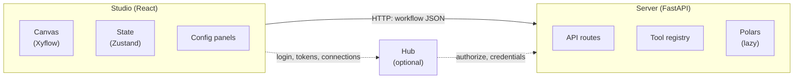

# Architecture Overview

Loom has a clear split between the UI, which never touches your data, and a service that does all the data processing. Understanding this split is the key to navigating the code.

## The big picture



Studio runs in an Electron or Tauri shell, or in a plain browser. The Full desktop builds bundle a Server and start it for you. Otherwise Studio talks to a Server you run. In Hub mode, Studio first gets a short-lived token from Hub. See [Component Relationships](./component-relationships.md).

## Monorepo structure

Everything lives in one repository, so a change to the workflow format, the Server that runs it, the Studio that edits it, the Hub that stores it and the docs that describe it can land in one commit.

```
server/                     Python: FastAPI + Polars
|-- app/
|   |-- api/                routes/ (HTTP handlers), models/ (Pydantic schemas)
|   |-- domain/
|   |   |-- tools/          implementations/, loaders/, registry, sockets
|   |   |-- execution/      planner, executor, cache manager, safety limits
|   |   |-- datasources/    inspect and preview per format
|   |   |-- connections/    credential store, URI building, query policy
|   |   |-- hub/            Hub client and heartbeat
|   |   |-- workflow/       Python code generator, archive
|   |   `-- registry.py     the single list of readable formats
|   |-- middleware/         auth, audit, rate limiting
|   `-- utils/
`-- tests/

studio/                     TypeScript: React + Vite
|-- src/
|   |-- components/         canvas/, config/, shell/, viewer/, ai/, ...
|   |-- state/              Zustand stores
|   |-- domain/             pure workflow logic and data source descriptors
|   |-- api/                Server and Hub clients
|   |-- platform/           Electron, Tauri and web adapters
|   |-- ai/                 AI agent, tools and prompts
|   |-- data/               tool definitions and config schemas
|   `-- themes/
|-- electron/               Electron main and preload
`-- tauri/                  Tauri (Rust) shell

hub/
|-- backend/                FastAPI + SQLAlchemy + Alembic (PostgreSQL)
`-- frontend/               React (Vite) admin and user app

docker/                     Production compose files
scripts/                    dev, test and build scripts
docs/                       This site
```

## Responsibilities

**Studio** handles what the user sees and touches: the canvas, tool configuration, undo history, tabs and settings. It saves and loads `.swwf` workflow files. It works with schemas and small previews. It never loads a dataset.

**Server** handles everything data-related: reading files and databases, running tools, propagating schemas, producing previews and profiles, and writing output.

**Hub** handles people and policy: accounts, roles, shared connections, workflow storage, schedules and the audit log.

Keeping data work out of the UI makes Studio responsive at any data size, and it means the same Server can be driven by Studio, Hub or a script.

## Communication

Studio and Server talk over HTTP with workflow JSON. Typical calls:

| User action | Request | Result |
| ----------- | ------- | ------ |
| Configure a tool | `POST /api/workflow/tool/metadata` | Upstream columns and types for dropdowns |
| Connect or change a tool | `POST /api/workflow/tool/schema` | The tool's output schema, without running it |
| Click a socket | `POST /api/workflow/tool/execute` | Sample rows for that socket |
| Preview All | `POST /api/workflow/preview_all` | Sample rows for every tool |
| Run | `POST /api/workflow/execute` | Runs the workflow, including Write tools |
| Profile a socket | `POST /api/workflow/tool/profile` | Column statistics over the full data |
| Open the code viewer | `POST /api/workflow/preview_code` | Generated Polars code |

See [API Endpoints](../reference/api-endpoints.md) for the full list.

## Studio at a glance

See [Studio Architecture](./frontend.md).

- **React 18** components, **Zustand** stores, **Xyflow** canvas, **Vite**, **Tailwind**.
- Stores split by concern: `workflowStore`, `historyStore`, `tabStore`, `uiStore`, `settingsStore`, `executionStore`, `connectionStore`, `clipboardStore`, `runtimeLogStore`, `aiStore` and `autoConnectPreviewStore`.
- A platform adapter isolates Electron, Tauri and browser differences.

## Server at a glance

See [Server Architecture](./backend.md).

- **FastAPI** for the API, **Pydantic** for schemas, **Polars** for data.
- A decorator-based **tool registry**. Each tool declares `execute`, `get_output_schema` and `validate_config`.
- The executor is built from a **planner** (dependency order), a **cache manager** (lineage hashes and disk cache) and the **executor** itself (sequential or parallel).

```python
@register_tool("Filter")
class FilterTool(BaseTool):
    engine = "core/polars"   # the default, inherited from BaseTool

    async def execute(self, config, inputs):
        ...
```

Each tool's engine is resolved with the precedence `tool.engine`, then `meta.defaultEngine`, then `DEFAULT_ENGINE`. Only `core/polars` exists today.

Socket IDs (`input`, `output`, `output-true` and so on) are constants in both `server/app/domain/tools/sockets.py` and `studio/src/domain/workflow/constants/socketIds.ts`, and tests check that they match.

## Data flow example

A user connects a Read tool (`Input`) to a Filter tool:

1. The Read tool is configured with `data.csv`.
2. Studio calls `POST /api/workflow/tool/schema` with the workflow. The Server inspects the file and returns the columns and types.
3. Studio fills the Filter's column dropdown from that schema.
4. The user configures the filter: `age > 30`.
5. Studio asks for the Filter's output schema again. It has the same columns, and the row count is unknown until it runs.
6. The user clicks the Filter's `T` socket. Studio calls `POST /api/workflow/tool/execute`.
7. The Server builds a lazy query for Read then Filter, limits it to the preview row count, collects it and returns the rows.
8. Studio shows them in the Data Preview tab.

Because Polars is lazy, step 7 reads only as much of the file as it needs.

## Design decisions

For the reasoning behind the major choices, see [Architectural Decisions](./decisions.md).

---

Next: [Studio Architecture](./frontend.md) or [Server Architecture](./backend.md).
