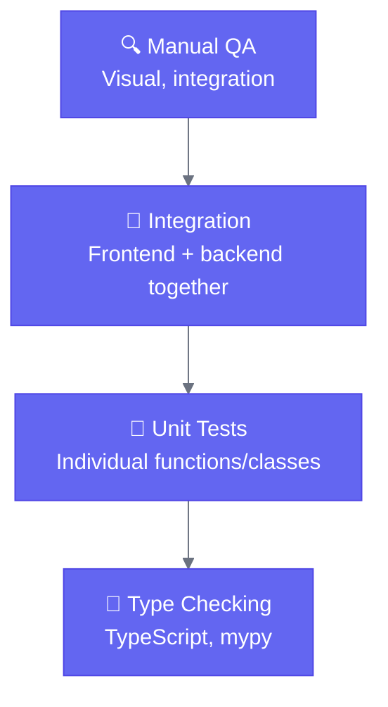

# Testing Philosophy

Sigilweaver's testing philosophy: **test the bones, not the skin.**

## What This Means

The "bones" are the core business logic: data transformations, workflow execution, state management, serialization. These must be correct; bugs here are hard to find in production.

The "skin" is the UI presentation: button colors, layout, CSS classes. This changes frequently during development and is easy to verify manually.

We test the bones heavily. We test the skin lightly.

## Why This Approach?

### 1. Stability Where It Matters

Data transformations must be bulletproof. A bug in the Filter tool means wrong results. A bug in workflow execution means data corruption. These are worth extensive testing.

A button that's 2 pixels off? Fix it when you notice, but don't write a regression test.

### 2. Development Velocity

During active development, UI changes constantly. If every component has snapshot tests, you spend more time updating snapshots than writing features.

Domain logic, on the other hand, has stable interfaces. Tests written once remain valid as the UI evolves.

### 3. Return on Investment

Time spent testing has diminishing returns. The first test for a function catches obvious bugs. The tenth test for the same function catches edge cases you'll never hit.

Allocate testing time to high-impact areas:
- Core execution engine
- Tool implementations  
- State management
- Serialization/deserialization

Low-impact areas get less attention:
- Component rendering
- CSS styling
- Animation timing

### 4. Early-Stage Pragmatism

Sigilweaver is pre-v1.0. The UI will change significantly before release. Writing comprehensive UI tests now means rewriting them later.

Domain logic is more stable. The tool interface won't change much. Invest in tests that will remain valuable.

## What We Test Heavily

### Backend

| Area | Why | Example |
|------|-----|---------|
| Tool execution | Data correctness | `test_filter_excludes_matching_rows` |
| Schema propagation | UI depends on it | `test_formula_adds_column_to_schema` |
| Execution graph | Order matters | `test_executes_dependencies_first` |
| Cycle detection | Prevents infinite loops | `test_rejects_circular_workflow` |
| Type mapping | Serialization | `test_polars_to_json_type_conversion` |

### Frontend

| Area | Why | Example |
|------|-----|---------|
| Serialization | Data integrity | `test_round_trip_preserves_workflow` |
| Loop detection | Graph validation | `test_detects_simple_cycle` |
| Store actions | State correctness | `test_add_tool_creates_entry` |
| Undo/redo | History integrity | `test_undo_restores_previous_state` |
| ID generation | Uniqueness | `test_generates_unique_ids` |

## What We Test Lightly

| Area | Approach | Rationale |
|------|----------|-----------|
| Component rendering | Basic render tests only | Changes frequently |
| CSS/Tailwind | Manual verification | Tooling handles it |
| Electron integration | Manual testing | Hard to automate |
| Visual appearance | Human eyes | Machines can't judge aesthetics |

## Testing Hierarchy



Most bugs are caught by type checking. Unit tests catch logic errors. Integration tests catch communication issues. Manual QA catches visual problems.

## Practical Guidelines

### Write a Test When

1. You fix a bug (prevent regression)
2. You implement a new tool (verify correctness)
3. Logic is complex enough you're not sure it's right
4. The function is used in multiple places

### Skip Tests When

1. It's pure presentation (CSS, layout)
2. You're iterating rapidly on UI
3. The code is trivially simple
4. Testing would be harder than the feature

### Test Structure

```python
# Arrange
tool = FilterTool()
input_data = pl.LazyFrame({...})
config = {"expression": "age > 30"}

# Act
result = await tool.execute(config, {"input": input_data})

# Assert
df = result["output"].collect()
assert len(df) == expected_count
```

### Test Naming

```python
# Good - describes behavior
def test_filter_excludes_rows_not_matching_expression():

# Bad - describes implementation
def test_filter_calls_polars_filter():

# Good - documents edge case
def test_filter_handles_empty_input():

# Bad - vague
def test_filter_works():
```

## Running Tests

```bash
# All tests
python ./scripts/test.py

# Backend only
cd backend && pytest

# Frontend only
cd frontend && npm test

# With coverage
cd backend && pytest --cov=app --cov-report=html
cd frontend && npm run test:coverage

# Specific file
cd backend && pytest tests/test_filter.py -v
cd frontend && npm test FilterConfig

# Watch mode (frontend)
cd frontend && npm run test:watch
```

## Coverage Goals

We don't target a specific coverage percentage. High coverage of trivial code isn't valuable; lower coverage of critical code is a problem.

Focus on:
- 90%+ coverage for tool implementations
- 90%+ coverage for execution engine
- 80%+ coverage for state stores
- Don't stress about component coverage

---

Next: [Backend Testing](./backend) and [Frontend Testing](./frontend) for specific patterns.
